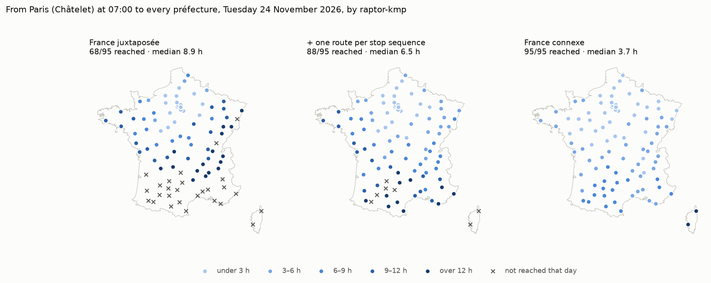
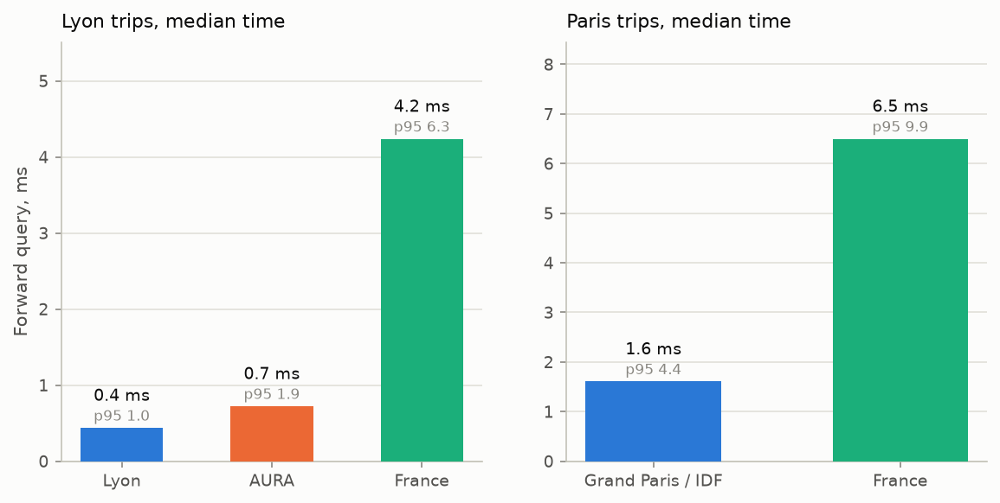
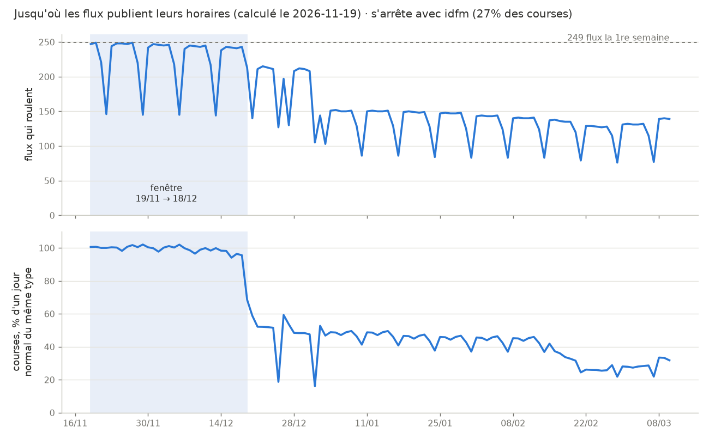

# raptor-kmp peut-il calculer des itinéraires sur toute la France ?

*[English version](RESULTS.md)*

## La réponse courte

**Oui.** Le benchmark a construit un seul GTFS pour toute la France métropolitaine :

- tous les réseaux urbains ;
- les cars régionaux et les TER ;
- la couche longue distance : TGV, OUIGO, Intercités, trains internationaux, FlixBus,
  BlaBlaCar Bus et ferries vers la Corse.

Cela fait 294 130 arrêts et 481 983 courses sur une journée. raptor-kmp le charge en une
demi-seconde, le tient en 257 Mo et atteint dans la journée chacune des 95 préfectures
depuis Paris.

- **Sur un serveur, il passe tous les objectifs fixés**, avec une large marge.
- **Sur un téléphone, la mémoire et le chargement passent**, et depuis les étapes 12–13
  sans demander de grand tas : avec raptor-kmp `2.4.0-SNAPSHOT` (branche
  `perf/memory-256`), la France occupe 124 Mo au lieu de 257, et se charge et répond dans
  un tas de 224 Mo.
  - Les trajets du quotidien sont rapides : la moitié des trajets dans Lyon ou dans Paris
    prennent moins de 8 ms.
  - Les 5 % de recherches les plus lentes prennent environ 36 ms, pour un objectif de
    30 ms : c'est proche, mais toujours pas atteint. Ce sont les longues recherches à
    travers le pays et les recherches « arriver avant » (voir
    [Ce qui ralentit une recherche](#ce-qui-ralentit-une-recherche)).

Les étapes 9 à 13 ont ensuite ajouté ce dont une appli a besoin autour : la recherche par
adresse, toutes les lignes scolaires avec un interrupteur, des données qui gardent des
semaines d'avance grâce à une mise à jour quotidienne, et le travail sur le moteur. Tout
est raconté dans [Après le premier verdict](#après-le-premier-verdict-étapes-913).



*Depuis Châtelet à 07:00, raptor-kmp cherche un itinéraire vers chaque préfecture.
À gauche : les réseaux régionaux seuls. Au milieu : les mêmes, une fois que le pipeline
ne perd plus de courses. À droite : avec la couche longue distance.*

### En un coup d'œil

France connexe, JVM de bureau, quatre exécutions ; la dernière colonne est la France
complète (avec toutes les lignes scolaires) sur le moteur des étapes 12–13. Les objectifs
ont été fixés avant de mesurer.

| | raptor-kmp 2.2.0 | Objectif téléphone | Objectif serveur | 2.4.0-SNAPSHOT |
|---|---|---|---|---|
| Chargement du réseau | 0,49–0,57 s | ≤ 3 s ✅ | — | 0,46 s |
| Mémoire occupée une fois chargé | 257 Mo | ≤ 512 Mo ✅ (avec `largeHeap`) | ≤ 4 Go ✅ | **124 Mo** |
| Plus petit tas qui permet de le charger | 384 Mo (échec à 320 Mo) | | | **224 Mo** |
| Un trajet dans Lyon / dans Paris, cas typique (médiane) | 4,6–5,0 ms / 7,6–7,9 ms | | | 5,3 / 8,4 ms |
| 5 % de recherches les plus lentes (p95) | 38–46 ms | ≤ 30 ms ❌ | ≤ 50 ms ✅ | 36 ms ❌ |
| 1 % de recherches les plus lentes (p99) | 115–123 ms | — | ≤ 200 ms ✅ | 49 ms |

**Comment lire ce tableau :**

- **p95** est la durée en dessous de laquelle se terminent 95 % des recherches. **p99**,
  la même chose pour 99 %.
- Ces temps sont mesurés sur un ordinateur portable (Intel Core Ultra 5). Un téléphone est
  plus lent : notre estimation est ×3, sans mesure.
- **`largeHeap`** est l'option du manifeste Android qui permet à une appli d'utiliser plus
  de mémoire que les 192–256 Mo par défaut.

## Ce que couvre « toute la France »

**Inclus :** 235 sources, récupérées les 18 et 19 novembre 2026, avec les horaires du
mardi 24 novembre 2026 :

- le réseau de chaque métropole et la plupart des réseaux urbains ;
- les réseaux de cars régionaux et les agrégats régionaux ;
- tous les TER, tirés du flux national de la SNCF ;
- TGV INOUI, OUIGO, Intercités (jour et nuit), Lyria et ICE ;
- Trenitalia et Renfe, sur leurs portions françaises ;
- FlixBus et BlaBlaCar Bus ;
- Corsica Linea entre Marseille et la Corse.

Le catalogue, avec la raison de chaque source retenue ou écartée, est dans
[`catalog/`](catalog/README.md).

**Exclus :**

- **L'outre-mer.** Il n'est pas relié à la métropole et vit sur d'autres fuseaux horaires.
- **Le transport à la demande.** Il n'a pas d'horaires fixes sur lesquels calculer.
- **Les réseaux uniquement scolaires**, dans le premier verdict. L'étape 10 les ajoute
  (France complète), avec un interrupteur pour écarter toutes les lignes scolaires.
- **Une poignée de réseaux dont les données ouvertes ont expiré ou disparu :** Ruban
  (Bourgoin-Jallieu), TAC, Ogalo, EVA'D, Mobilité en Velay et le chemin de fer corse.
- **Eurostar et les ferries transmanche.** Ils n'apportent rien à l'intérieur de la
  France : chacune de leurs courses ne s'arrête qu'une fois en France.

## Trois problèmes corrigés en chemin

Un réseau de toute la France ne fonctionnait pas tel quel. Il a fallu corriger trois
choses. Chacune a été mesurée, et les deux premières ne sont pas propres à la France :
elles touchent n'importe quelle ville.

### 1. Les arrêts qui portent le même nom

raptor-kmp relie par une marche de 2 minutes chaque paire d'arrêts au nom strictement
identique. Dans une ville, c'est ce qui relie entre eux les quais d'une gare. À l'échelle
de la France, chaque « Gare », « Mairie » ou « Église » se retrouve reliée à toutes les
autres : 15,8 millions de liens.

Les recherches devenaient 5 à 10 fois plus lentes. Pire, les itinéraires étaient faux :
un trajet pouvait « marcher » de la mairie d'une ville à celle d'une autre, à 200 km.

**Correction, dans les données :** les arrêts de même nom mais éloignés prennent le nom
de leur commune (« Mairie (Vénissieux) »). C'est un contournement : le moteur devrait
limiter ces liens à une distance. → [détails](#a-les-arrêts-de-même-nom)

### 2. Les courses que le pipeline jette

Le pipeline garde une seule suite d'arrêts par ligne et par sens, la plus fréquente. Une
course qui saute l'un de ces arrêts est écartée : un TER direct, un TGV qui ne s'arrête
pas à Mâcon, un bus du dimanche qui passe ailleurs. Sur la France, cela représente
**17 % des courses de la journée**.

**Correction :** donner à chaque suite d'arrêts sa propre route.

- Le benchmark le fait lors de la fusion.
- Le commit `273aac0` de la branche Toulon fait la même chose dans le pipeline lui-même.
- Les deux ont été mesurés sur la France : même réseau, course pour course, et mêmes
  itinéraires vers les 95 préfectures.

Effets :

- 99,9 % des courses conservées ;
- avec les seuls réseaux régionaux, 88 préfectures accessibles depuis Paris au lieu
  de 68 ;
- coût : environ 25 Mo de mémoire.

### 3. Une France sans trains longue distance

Au départ, les régions n'étaient reliées que par les TER. En tant que graphe, la France
formait déjà un seul bloc : 99,7 % des arrêts pouvaient s'atteindre les uns les autres,
puisque des lignes TER franchissent chaque frontière régionale. Mais c'était lent :
Lyon → Paris prenait dix heures et demie, et Bordeaux → Nice était impossible dans la
journée.

**Correction :** ajouter la couche longue distance, avec des liaisons à pied plus larges
autour des gares, pour qu'un quai de TGV rejoigne le métro qui est devant.

| Départ 07:00 | Régional seul | Régional, toutes les courses | France connexe |
|---|---|---|---|
| Préfectures accessibles depuis Paris | 68 / 95 | 88 / 95 | **95 / 95** |
| Durée typique vers une préfecture (médiane) | 8 h 53 | 6 h 29 | **3 h 40** |
| Lyon Part-Dieu → Paris Gare de Lyon | 10 h 30 | 8 h 27 | **2 h 02**, TGV direct |
| Lille Flandres → Marseille St-Charles | aucun | aucun | **5 h 14** |
| Brest → Strasbourg | aucun | aucun | **7 h 30** |
| Bordeaux St-Jean → Nice-Ville | aucun | aucun | **9 h 06** |

La Corse est atteinte par le ferry de nuit, qui arrive à 07:00 le lendemain.

Ce qui reste isolé est minuscule : 0,07 % des arrêts. Ce sont quelques réseaux ruraux ou
scolaires sans aucune liaison à pied vers le reste, et le Pays de Gex, dont la liaison
passe par le réseau de Genève, de l'autre côté de la frontière.
→ [détails](#b-les-trois-réseaux-france)

## Ce qui ralentit une recherche

Trois choses pèsent sur la durée d'une recherche. Seule la première est une faiblesse du
moteur.

**1. Un coût fixe qui grandit avec le réseau.** Avant chaque recherche, raptor-kmp remet
à zéro sa mémoire de travail pour *tous* les arrêts du réseau, même quand le trajet ne
traverse qu'une ville. Un même trajet dans Lyon, avec la même réponse, prend :

- 0,4 ms sur le réseau lyonnais ;
- 0,7 ms sur Auvergne-Rhône-Alpes ;
- 4,2 ms sur la France.

Environ 4 ms viennent de cette remise à zéro. Ne remettre à zéro que ce que la recherche
précédente a touché devrait en supprimer l'essentiel. C'est le principal levier pour les
téléphones.



**2. Plus de réponses à trouver.** Sur la France régionale, la plupart des paires
d'arrêts tirées au hasard à travers le pays n'ont pas de réponse, et la recherche
abandonne tôt. Sur la France connexe, 3,6 fois plus de paires sont reliées : les
recherches vont donc plus loin avant de conclure. C'est pourquoi les 5 % les plus lentes
sont passées de 12 ms à 40 ms. C'est le prix d'un réseau qui marche vraiment de bout en
bout.

**3. Plus de correspondances permises.** Les applis autorisent 4 correspondances
(5 « tours » dans le vocabulaire de RAPTOR). Nous en avons essayé 7 :

- les 5 % de recherches les plus lentes ont encore doublé (94 ms) ;
- aucun des longs trajets n'en avait besoin : les quatre étaient déjà trouvés avec
  4 correspondances.

**Gardez la valeur par défaut.**

## La mémoire

La mémoire grandit au même rythme que le réseau : environ 0,9 Ko par arrêt. Une ville
occupe quelques Mo, une région jusqu'à 40 Mo, la France 257 Mo une fois chargée.

Le chargement demande davantage : environ 400 Mo au plus haut, parce que le fichier et le
réseau en construction sont en mémoire en même temps. La France connexe se charge donc
avec un tas de 384 Mo, mais pas avec 320 Mo.

- Sans `largeHeap`, beaucoup de téléphones Android donnent 192–256 Mo à une appli, ce qui
  ne suffit pas.
- C'était raptor-kmp 2.2.0 : les étapes 12–13 divisent le réseau par deux et abaissent le
  pic, voir [Un moteur à la taille d'un téléphone](#un-moteur-à-la-taille-dun-téléphone).

## Le pipeline

Le pipeline convertit toute la France en environ 2 minutes 30, sans modification. Il lui
faut pour cela environ 10 Go de mémoire : il lit toute la semaine que lui fournit la
fusion, alors qu'il n'en écrit qu'un jour. Ne lire que le jour converti réduirait
beaucoup ce besoin.

| | France régionale | France connexe |
|---|---:|---:|
| Durée de conversion | 136 s | 157 s |
| Pic de mémoire | 9,3 Go | 9,6 Go |
| Sortie (`stops.bin` + `routes.bin`) | 64 Mo | 76 Mo |

## Après le premier verdict (étapes 9–13)

### Chercher depuis une adresse

La console cherche les adresses comme Pelo : le géocodeur public Photon, puis le point
lui-même transmis à raptor-kmp (`Location.Point`). Le moteur marche jusqu'à tous les
arrêts à moins de 500 m, chacun avec sa propre marche, et propose le trajet tout à pied
sous 1 km. S'il ne trouve rien, il recommence en marchant jusqu'à 6 km.

**Ce que ça coûte : presque rien.** Le moteur construit une grille des arrêts à la
première recherche par adresse : 7 Mo sur la France. Ensuite, une recherche depuis une
adresse coûte à peu près ce que coûte une recherche depuis tous les arrêts autour. Elle
est même souvent *plus rapide* qu'une recherche depuis le seul arrêt le plus proche :
partir du bon arrêt du quartier raccourcit la recherche.

| France connexe, recherche médiane | Paris (300 trajets) | Lyon (300 trajets) | À travers la France (1 000) |
|---|---:|---:|---:|
| Depuis l'arrêt le plus proche | 21,7 ms | 8,0 ms | 13,4 ms, 186 trouvés |
| Depuis tous les arrêts à 500 m | 9,8 ms | 7,5 ms | 27,0 ms, 283 trouvés |
| **Depuis l'adresse** | **11,0 ms** | **8,3 ms** | **26,0 ms, 281 trouvés** |

À travers la France, la recherche par adresse est plus lente parce qu'elle trouve moitié
plus de trajets. Trouver l'adresse est une requête web (0,1 à 0,3 s) qui ne passe jamais
par le moteur. → `results/address_queries.csv`

### Toutes les lignes scolaires, avec un interrupteur

Les 18 sources qui ne transportent que des scolaires rejoignent une troisième couche du
catalogue, lue par un réseau de plus, la **France complète**. Une ligne compte comme
scolaire par l'une de cinq règles :

- sa source est entièrement scolaire ;
- son type GTFS le dit (712/713, comme les JD des TCL) ;
- son nom le dit (« ligne scolaire ») ;
- la convention propre au réseau (Rennes : Ts30…) ;
- elle dessert un collège, un lycée ou une école, et roule au plus 6 fois dans la journée.

Une ligne qui finit simplement à un lycée roule toute la journée et reste une ligne
normale.

| | |
|---|---|
| Lignes scolaires de la France complète | 7 628 (2 427 par source scolaire, 3 220 par type, 1 526 « peu de courses », 417 par nom, 38 par convention) |
| Leurs courses le 24 novembre | 21 329, soit 4,3 % de la journée |
| France complète | 313 419 arrêts, 489 575 courses, 95 / 95 préfectures |

L'interrupteur « lignes scolaires » de l'explorateur les écarte d'une recherche. Un cas
réel : Saint-Jeannet → Logis du Pin à 06:40 prend la ligne scolaire 23S, en 58 min ; sans
les lignes scolaires, il n'y a aucun trajet, même en marchant 6 km.

Écarter les scolaires ajoute 3 à 4 ms par recherche (médiane à Lyon : 5,0 → 8,7 ms). C'est
que raptor-kmp compare chaque ligne à la liste à chaque recherche : une correction à faire
dans le moteur. → `results/school_routes.csv`, `school_switch.csv`

### Des données qui gardent de l'avance

raptor-kmp n'a pas de calendrier : un réseau, ce sont les horaires d'un jour. Pelo sert
TCL, dont le fichier couvre des mois, avec quelques jours types. Pour la France, la
question est de savoir jusqu'où *tous* les producteurs publient. La réponse : des
semaines, pas des mois.



Le 19 novembre 2026, tous les flux qui comptent avaient des horaires jusqu'au
**18 décembre**, dernier jour d'IDFM (27 % des courses ; IDFM publie environ un mois à
l'avance). Six petits flux, qui pèsent 0,28 % des courses, s'arrêtent avant :

- deux navettes de ski entre deux saisons ;
- Pastel ;
- Bourg-Saint-Maurice ;
- Trenitalia ;
- Pays de Gex.

Après le 18 décembre, la moitié des courses disparaît d'un coup.

La fenêtre **glisse** donc. `python -m gtfs_bench.refresh`, prévu pour tourner chaque
nuit :

- télécharge ce qui a changé. Plusieurs API refabriquent un zip identique à chaque
  requête : un changement, c'est donc un changement des fichiers à l'intérieur du zip ;
- signale les nouveaux fichiers du PAN pour les flux qui s'arrêtent bientôt ;
- recalcule la fenêtre ;
- ne reconstruit le réseau que si besoin, en une dizaine de minutes.

Le réseau, **france-live**, contient trois jours types : les horaires d'un mardi, d'un
samedi et d'un dimanche. Chaque date prend son jour type ; les jours fériés prennent celui
du dimanche.

| france-live, données du 19 nov. | semaine | samedi | dimanche |
|---|---:|---:|---:|
| Courses | 487 666 | 316 621 | 151 732 |
| Mémoire, raptor-kmp 2.2.0 | 274 Mo | 236 Mo | 212 Mo |
| Mémoire, 2.4.0-SNAPSHOT | 123 Mo | 95 Mo | 73 Mo |

### Un moteur à la taille d'un téléphone

Le relevé des objets en mémoire d'une France chargée montrait où partait la mémoire de la
2.2.0 :

- chaque correspondance à pied était un objet, dans une liste par arrêt, puis recopiée
  deux fois dans des tableaux ;
- une table traduisait chaque numéro d'arrêt en position, alors que c'est déjà la même
  chose ;
- les groupes d'arrêts de même nom étaient rangés dans des tables de listes d'entiers
  « boxés ».

Les étapes 12 et 13 ont réécrit cela dans raptor-kmp (branche `perf/memory-256`, version
`2.4.0-SNAPSHOT`), sans changer son API :

- correspondances, lignes par arrêt et groupes de même nom deviennent des tableaux plats,
  que la recherche lit directement ;
- les correspondances lues dans le fichier servent telles quelles, dans le tableau même
  que le chargeur a rempli ;
- une seule période construite à la fois, et les octets des fichiers libérés dès qu'ils
  sont lus ;
- un état de recherche de 20 octets par arrêt et par tour au lieu de 32.

| | 2.2.0 | 2.4.0-SNAPSHOT |
|---|---:|---:|
| France complète, mémoire occupée | 275 Mo | **124 Mo** |
| France complète, plus petit tas | 384 Mo | **224 Mo** |
| France connexe, plus petit tas | 384 Mo | **192 Mo** |
| Les trois jours types l'un après l'autre | ne se charge pas dans 256 Mo | **les trois dans 224 Mo** |
| Recherches au hasard, p95 (complète) | 42 ms | 36 ms |

**Les trajets sont identiques.** On a fait 2 500 recherches fixes (sens normal,
arriver-avant, depuis des adresses, sans lignes scolaires), sur Lyon et trois réseaux
France. Chaque champ de chaque trajet donne le même hachage avec les deux moteurs.
→ `results/engine_memory.csv`, `engine_periods.csv`

### La console

Tout se pilote depuis une seule application de terminal,
`python -m gtfs_bench.console` :

- l'itinéraire et la carte ;
- le catalogue, modifiable, avec des copies de sauvegarde ;
- les réseaux convertis ;
- chaque étape du notebook et les mesures, lancées comme des actions dont on voit la
  sortie ;
- les paramètres, les résultats et le guide.

Le guide, avec des captures d'écran : [`docs/guide-console.pdf`](docs/guide-console.pdf).

## Limites

- **Aucun téléphone n'a été mesuré.** Les chiffres de mémoire valent pour Android,
  puisque les mêmes données y sont allouées. Pas les temps. ART range aussi autrement les
  noms accentués et les en-têtes d'objets : les 32 Mo de marge sous 256 Mo devraient
  suffire, mais ce n'est pas mesuré.
- **Un horaire par jour type.**
  - Un jour de semaine prend les horaires du mardi : une course qui ne roule que le
    mercredi ou le vendredi manque.
  - Un trajet qui demande deux jours (un ferry de nuit, puis une correspondance le matin)
    est introuvable.
  - La fenêtre couvre la période que tous les producteurs importants ont publiée : des
    semaines, jamais des mois.
- **Les lignes scolaires sont repérées par des règles**, pas déclarées par les
  producteurs : quelques-unes peuvent manquer ou être mal marquées
  (`results/school_routes.csv` les liste toutes, avec la règle appliquée).
- **Pas de règles de réservation.** Le pipeline ignore les restrictions de montée et de
  descente. FlixBus et BlaBlaCar n'en déclarent aucune, donc rien n'est perdu de ce côté.
  Un car « à réservation » est traité comme n'importe quel autre.
- **Les 36 petits réseaux de la courbe de taille** (22 métropoles, 13 régions) ont été
  mesurés avant la correction n° 2. Il leur manque 4 à 30 % de leurs courses. Leurs temps
  et leur mémoire restent justes pour ce qu'ils contiennent.

## Et maintenant

**Dans raptor-kmp :**

1. **Publier la 2.4.0** depuis `perf/memory-256` : réseau à plat, une période à la fois,
   état de recherche plus petit. C'est fait, avec des trajets identiques. Pelo pourra alors
   utiliser `RaptorLibrary(periods, keepAllPeriods = false)` pour ses jours types.
2. **Ne remettre à zéro que ce que la recherche précédente a touché.**
   - Un trajet urbain sur la France reviendrait alors près de son coût sur la ville seule.
   - C'est le changement qui devrait faire passer les téléphones sous 30 ms : une
     estimation, à mesurer une fois fait.
3. **Construire une seule fois le filtre des lignes écartées**, au lieu de tester chaque
   ligne à chaque recherche : l'interrupteur des lignes scolaires ne coûterait alors plus
   rien.
4. **Limiter à une distance les liens entre arrêts de même nom**, ou les abandonner au
   profit de `transfers.txt`. Plus aucun réseau fusionné n'aurait alors besoin du
   contournement par renommage.

**Dans le pipeline :**

1. **Fusionner la correction « une route par suite d'arrêts »** (commit `273aac0`), après
   avoir vérifié que les applis ne lisent pas les routes d'une ligne comme ses deux sens.
   C'est un changement cassant : le commit passe d'ailleurs la version à 0.5.0.
2. **Ne lire que le jour converti**, pour faire passer la France bien sous 10 Go.
3. Fixer le démon Gradle sur le JDK 21 : Kotlin 2.1.0 échoue avec le JDK 25.

**Dans le benchmark :**

- mesurer sur un vrai téléphone, avec france-live et raptor-kmp 2.4.0 ;
- planifier la mise à jour quotidienne (console, Actions → « Planifier la mise à jour
  quotidienne »).

## Méthode

- **Données :** les sources retenues du catalogue
  ([`catalog/gtfs_france.csv`](catalog/gtfs_france.csv)), téléchargées les 18 et
  19 novembre 2026. Chaque version utilisée est dans
  [`results/feeds_used.csv`](results/feeds_used.csv).
- **Jour :** le mardi 24 novembre 2026, le mardi scolaire où circulent le plus de sources
  (220 sur 225). La fusion garde sa semaine ; le pipeline convertit le jour.
- **Fusion** (`gtfs_bench/`) :
  - chaque identifiant préfixé par sa source ;
  - courses présentes en double supprimées ;
  - homonymes éloignés renommés ;
  - correspondances à pied générées (300 m, et 500 m autour des gares).
- **Réseaux :**
  - 22 métropoles ⊂ 13 régions ⊂ la France (la courbe de taille, couche régionale) ;
  - trois versions de la France pour l'étape 8 : régionale seule, toutes les courses,
    connexe.
- **Pipeline :** `main`, sans modification, JDK 21.
- **Moteur :** `eu.dotshell:raptor-kmp-jvm` 2.2.0 depuis Maven Central, une JVM neuve
  par exécution, 4 correspondances permises (le réglage par défaut des applis).
- **Recherches :**
  - 1 000 paires d'arrêts aléatoires à travers le réseau, en départ et en « arriver
    avant » ;
  - 300 trajets dans Lyon et 300 dans Paris, rejoués sur chaque réseau qui contient la
    ville ;
  - dix trajets nommés ;
  - Paris → chaque préfecture.
- **Contre-vérification :** sur Lyon, une recherche aléatoire prend 0,46 ms en moyenne.
  Le benchmark de raptor-kmp donne 0,35 ms, sur un export TCL plus ancien.
- **Machine :** Intel Core Ultra 5 135H, 15 Go, Windows 11.

## Annexe : le détail

Chaque chiffre ci-dessus vient d'un fichier de [`results/`](results/). Les tableaux
ci-dessous sont ceux qui valent la lecture ; les fichiers CSV contiennent tout.

### A. Les arrêts de même nom

La même France, fusionnée avec les noms d'arrêts des producteurs, convertie et mesurée
de la même façon ([`engine_same_name_links.csv`](results/engine_same_name_links.csv)).

| France régionale | Renommés (benchmark) | Noms des producteurs |
|---|---:|---:|
| Liens de même nom créés par le moteur | 318 110 | 15 787 962 |
| Plus grand groupe d'arrêts portant un même nom | 23 | 2 669 |
| Mémoire occupée | 229 Mo | 282 Mo |
| Trajets dans Lyon, médiane / p95 | 4,2 / 6,3 ms | 37,1 / 70,7 ms |
| Trajets dans Paris en « arriver avant », p95 / p99 | 23,3 / 91,4 ms | 561,7 / 678,6 ms |
| Paires aléatoires « reliées » | 51 / 1 000 | 518 / 1 000 |
| Trajet typique dans Paris | 36 min | 20 min |

Les deux dernières lignes sont les itinéraires faux. Dix fois plus de paires sont
« reliées », et les trajets parisiens raccourcissent de 16 minutes, en sautant d'une
ville à l'autre par un nom d'arrêt partagé.

### B. Les trois réseaux France

([`connected_france.csv`](results/connected_france.csv),
[`connected_scenarios.csv`](results/connected_scenarios.csv),
[`connectivity_islands.csv`](results/connectivity_islands.csv),
[`reachability_prefectures.csv`](results/reachability_prefectures.csv))

| | Régional seul | Toutes les courses | France connexe |
|---|---:|---:|---:|
| Sources | 225 | 225 | 235 |
| Courses gardées par le pipeline | 397 477 (83 %) | 480 669 (99,9 %) | 481 983 (99,9 %) |
| Routes chargées | 35 453 | 72 641 | 73 493 |
| Arrêts dans le plus grand bloc connexe | 99,71 % | 99,71 % | 99,93 % |
| Chargement | 436 ms | 563 ms | 571 ms |
| Mémoire occupée | 229 Mo | 254 Mo | 257 Mo |
| Paires aléatoires reliées (sur 1 000) | 51 | 78 | 183 |
| Recherche aléatoire, médiane / p95 / p99 | 4,0 / 11,5 / 14,6 ms | 5,8 / 20,7 / 27,4 ms | 10,7 / 40,4 / 54,7 ms |
| « Arriver avant », médiane / p95 / p99 | 6,2 / 15,0 / 18,4 ms | 8,8 / 26,1 / 34,4 ms | 15,2 / 45,6 / 63,8 ms |
| Trajets dans Lyon, médiane / p95 | 4,2 / 6,3 ms | 4,7 / 7,8 ms | 5,0 / 11,6 ms |
| Trajets dans Paris, médiane / p95 | 6,5 / 9,9 ms | 8,2 / 14,6 ms | 7,9 / 15,6 ms |
| Recherche aléatoire avec 7 correspondances, p95 | 27,9 ms | 56,1 ms | 94,3 ms |

La couche longue distance représente 1 324 courses le 24 novembre :

- 862 SNCF : 538 TGV INOUI, 120 cars à réservation, 71 OUIGO, 72 Intercités, 34 Lyria,
  26 ICE ;
- 323 FlixBus ;
- 100 BlaBlaCar Bus ;
- 26 Trenitalia ;
- 8 Renfe ;
- 5 traversées Corsica Linea.

La France connexe a été mesurée quatre fois. D'une exécution à l'autre, le chargement a
varié de 0,08 s et le p95 aléatoire de 2,5 ms
([`engine/variants/runs/`](results/engine/variants/runs/)).

**La correction de la branche Toulon, vérifiée.** La France connexe a été fusionnée sans
le découpage du benchmark, puis convertie par `main` + `273aac0` :

- mêmes 481 983 courses et 73 493 routes ;
- mêmes durées vers les 95 préfectures, mêmes longs trajets ;
- 6 Mo de mémoire en moins.

Avec `main` seul, 17 % des courses disparaissent et la Corse devient inaccessible.

### C. Chaque réseau de la courbe de taille

Les 36 réseaux de la couche régionale, avant la correction n° 2.

| Réseau | Arrêts | Chargement | Mémoire | Recherche aléatoire, médiane / p95 |
|---|---:|---:|---:|---:|
| Métropole du Grand Paris | 35 364 | 128 ms | 37 Mo | 4,23 / 7,71 ms |
| Métropole de Lyon | 9 625 | 56 ms | 9 Mo | 0,48 / 1,04 ms |
| Aix-Marseille-Provence | 9 848 | 60 ms | 9 Mo | 0,59 / 1,36 ms |
| Métropole européenne de Lille | 3 314 | 36 ms | 3 Mo | 0,24 / 0,39 ms |
| Bordeaux Métropole | 3 911 | 36 ms | 4 Mo | 0,26 / 0,41 ms |
| Toulouse Métropole | 3 811 | 37 ms | 4 Mo | 0,28 / 0,44 ms |
| Nantes Métropole | 2 479 | 26 ms | 2 Mo | 0,15 / 0,28 ms |
| Métropole Nice Côte d'Azur | 2 821 | 31 ms | 3 Mo | 0,17 / 0,34 ms |
| Eurométropole de Strasbourg | 1 335 | 26 ms | 1 Mo | 0,08 / 0,22 ms |
| Montpellier Méditerranée Métropole | 1 453 | 23 ms | 1 Mo | 0,07 / 0,14 ms |
| Rennes Métropole | 1 774 | 23 ms | 2 Mo | 0,14 / 0,25 ms |
| Grenoble-Alpes Métropole | 2 173 | 25 ms | 2 Mo | 0,10 / 0,21 ms |
| Métropole Rouen Normandie | 2 481 | 27 ms | 2 Mo | 0,13 / 0,26 ms |
| Toulon Provence Méditerranée | 2 013 | 26 ms | 2 Mo | 0,17 / 0,31 ms |
| Saint-Étienne Métropole | 2 279 | 23 ms | 2 Mo | 0,11 / 0,24 ms |
| Tours Métropole Val de Loire | 1 496 | 24 ms | 2 Mo | 0,10 / 0,21 ms |
| Orléans Métropole | 1 346 | 18 ms | 1 Mo | 0,07 / 0,16 ms |
| Dijon Métropole | 1 095 | 19 ms | 1 Mo | 0,08 / 0,16 ms |
| Metz Métropole | 1 086 | 22 ms | 1 Mo | 0,08 / 0,19 ms |
| Métropole du Grand Nancy | 962 | 22 ms | 1 Mo | 0,08 / 0,23 ms |
| Clermont Auvergne Métropole | 1 360 | 22 ms | 1 Mo | 0,07 / 0,20 ms |
| Brest Métropole | 1 052 | 21 ms | 1 Mo | 0,11 / 0,25 ms |
| Île-de-France | 35 401 | 136 ms | 37 Mo | 3,14 / 6,18 ms |
| Centre-Val de Loire | 11 372 | 57 ms | 8 Mo | 0,13 / 0,69 ms |
| Bourgogne-Franche-Comté | 10 496 | 55 ms | 7 Mo | 0,15 / 0,58 ms |
| Normandie | 12 518 | 60 ms | 9 Mo | 0,22 / 0,77 ms |
| Hauts-de-France | 31 392 | 110 ms | 23 Mo | 0,38 / 2,13 ms |
| Grand Est | 26 374 | 93 ms | 20 Mo | 0,25 / 1,33 ms |
| Pays de la Loire | 13 820 | 62 ms | 11 Mo | 0,29 / 0,84 ms |
| Bretagne | 17 217 | 65 ms | 12 Mo | 0,24 / 1,08 ms |
| Nouvelle-Aquitaine | 28 914 | 110 ms | 20 Mo | 0,26 / 1,69 ms |
| Occitanie | 24 051 | 80 ms | 17 Mo | 0,41 / 1,51 ms |
| Auvergne-Rhône-Alpes | 54 223 | 118 ms | 38 Mo | 0,39 / 3,69 ms |
| Provence-Alpes-Côte d'Azur | 26 942 | 108 ms | 24 Mo | 0,92 / 2,54 ms |
| Corse | 731 | 15 ms | 1 Mo | 0,02 / 0,05 ms |
| France métropolitaine | 293 369 | 436 ms | 229 Mo | 4,03 / 11,53 ms |

## Reproduire

Depuis `benchmark/`, avec l'environnement décrit dans le [README](README.md) :

```bash
JAVA_HOME=~/.gradle/jdks/eclipse_adoptium-21-amd64-windows.2 ../gradlew -p .. :cli:installDist :benchmark-engine:installDist
```

```bash
cd notebooks && ../.venv/Scripts/python -m jupyter nbconvert --to notebook --execute gtfs_france.ipynb --output out.ipynb
```

```bash
.venv/Scripts/python -m gtfs_bench.variants   # arrêts de même nom, facultatif
.venv/Scripts/python -m gtfs_bench.connected  # les réseaux France (étapes 8 et 10), ~25 min chacun
.venv/Scripts/python -m gtfs_bench.engine --addresses      # étape 9
.venv/Scripts/python -m gtfs_bench.refresh                 # étape 11 : france-live et la fenêtre
.venv/Scripts/python -m gtfs_bench.engines compare 2.2.0 2.4.0-SNAPSHOT   # étapes 12-13, voir le README
```

Ou tout depuis la console : `.venv/Scripts/python -m gtfs_bench.console`, onglet Actions.

Les sources changent tous les jours. Une nouvelle exécution choisit un autre jour de
référence et d'autres versions, et `results/feeds_used.csv` garde la trace des versions
utilisées.
