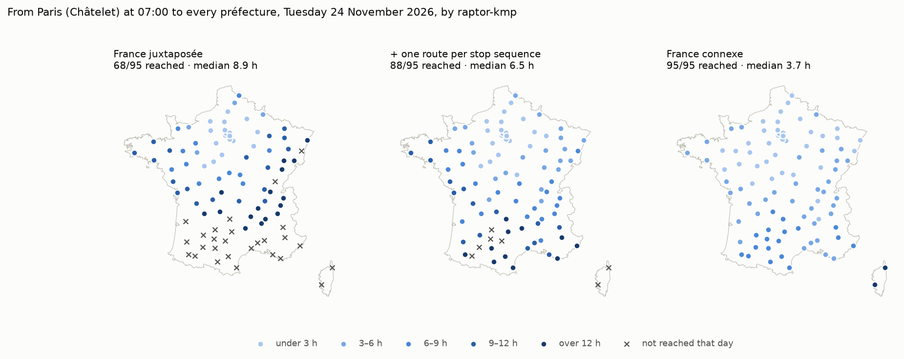
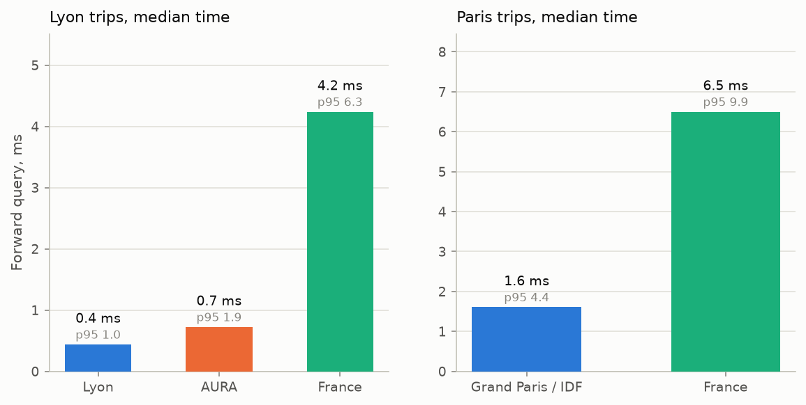

# Can raptor-kmp route over all of France?

**Yes for a server. For a phone, yes on memory and loading, not yet on its slowest
queries.** Step 8 built a France in one piece: every regional network, plus TGV, OUIGO,
Intercités, international trains, coaches and the Corsica ferries, with every trip the day
runs. raptor-kmp loads it in 0.57 s, holds 257 MB of heap, reaches all 95 préfectures from
Paris within the day, and answers a city trip in 5–8 ms (median, desktop JVM). Every
server criterion passes. On a phone, heap and load pass; the 30 ms p95 does not for
cross-country and arrive-by queries (40–46 ms).



Four conditions come with that answer:

1. **Stops sharing a name must not be linked across France.** raptor-kmp links every
   pair of same-name stops with a 120 s transfer. With the producers' names, that is 15.8
   million links. City trips then become 5 to 10 times slower at the median and up to 32
   times slower at the 95th percentile, and itineraries are wrong:
   trips "teleport" between towns that each have a "Gare" or a "Mairie". The merge renames
   homonyms by place; the engine should stop needing it.
2. **A phone needs a large heap.** France loads at -Xmx384m but not at -Xmx256m, which is
   what many Android phones give an app without `android:largeHeap`. The connected France
   still fits in 384 MB.
3. **The pipeline must keep every trip.** It keeps one stop sequence per route and
   direction and drops the trips that skip one of its stops: 17 % of the day's trips on
   France, express TER first. The merge now gives each stop sequence its own route, which
   keeps 99.9 % of them. On its own, that takes the regional France from 68 to 88
   préfectures reachable from Paris in a day.
4. **A connected network costs more per query.** A random trip's p95 goes from 11.5 ms
   (regional France) to 40 ms (connected), because far more pairs now have an answer to
   search for. Eight rounds instead of five double it again and find no long trip that
   five did not. raptor-kmp's per-query reset (see [Speed](#speed)) is the first thing
   to fix for phones.



## Verdict against the criteria

The criteria were fixed in the plan before measuring. Desktop JVM, default 5 rounds, the
worst query set of each network (random, Lyon and Paris trips, forward and arrive-by):

| Target | Criterion | Regional France (step 7) | | France connexe (step 8) | |
|---|---|---|---|---|---|
| Phone | heap ≤ 512 MB | loads at 384 MB (out of memory at 256 MB); holds 229 MB | ✅ with `largeHeap` | loads at 384 MB; holds 257 MB | ✅ with `largeHeap` |
| Phone | load ≤ 3 s on desktop (≈ 10 s on a phone, ×3 estimated) | 0.44 s | ✅ | 0.57 s | ✅ |
| Phone | p95 ≤ 30 ms on desktop | 23.3 ms (Paris trips, arrive-by) | ✅ | 45.6 ms (random, arrive-by); city trips forward 11.6–15.6 ms | ❌ |
| Server | heap ≤ 4 GB | 229 MB | ✅ | 257 MB | ✅ |
| Server | p95 ≤ 50 ms | 23.3 ms | ✅ | 45.6 ms | ✅ |
| Server | p99 ≤ 200 ms | 91.4 ms (Paris trips, arrive-by) | ✅ | 115.4 ms (Lyon trips, arrive-by) | ✅ |

The same France **with the producers' stop names fails all three latency criteria**:
p95 up to 562 ms and p99 up to 836 ms, with wrong itineraries (see
[Same-name links](#same-name-links)).

## What was measured

- **Data:** the 225 included feeds of [`catalog/gtfs_france.csv`](catalog/gtfs_france.csv):
  urban, interurban, regional aggregates and TER from the national SNCF feed. They were
  downloaded on 18 November 2026; every version is in
  [`results/feeds_used.csv`](results/feeds_used.csv).
- **Step 8 data:** the 10 long-distance rows of the catalogue, downloaded on 19 November
  2026. The SNCF zip is the same version as the TER's.
- **Reference day:** Tuesday 24 November 2026, chosen from the calendars as the school
  Tuesday the most feeds run on (220 of 225).
- **Merge:** the merge keeps that day's week; the pipeline converts the day alone.
- **Tiers:** 22 métropoles ⊂ 13 regions ⊂ mainland France, 36 networks in all.
- **Pipeline:** `main` at the start of the branch, unmodified, JDK 21, `-Xmx12g`.
- **Engine:** `eu.dotshell:raptor-kmp-jvm` 2.2.0 from Maven Central, JDK 21, one fresh
  JVM per network, `maxRounds = 5` (the default the apps use).
- **Machine:** Intel Core Ultra 5 135H, 15 GB, Windows 11.

Query sets:

- **random:** 1,000 seeded pairs over all of a network's stops, departures 6:00–21:59,
  forward and arrive-by. This is the same generator as raptor-kmp's JMH benchmark.
- **local:** 300 seeded trips drawn inside Lyon and inside Paris. Each endpoint is the set
  of stops within 400 m. The same places are replayed on every network that holds the
  city.
- **named:** fixed trips from Bellecour → Part-Dieu to Brest → Strasbourg.

**Cross-check:** on Lyon, a random forward query takes 0.46 ms on average here.
raptor-kmp's README gives 0.35 ms on average, on an older, larger TCL export.

## France connexe (step 8)

Three networks, each adding one thing to the one before
([`results/connected_france.csv`](results/connected_france.csv), built by
`gtfs_bench/connected.py`):

| Network | What it is | Feeds | Trips of the day the pipeline keeps |
|---|---|---:|---:|
| **France juxtaposée** | the France tier of steps 3–7: the regions side by side, joined by TER and walks | 225 | 397 477 / 481 003 (83 %) |
| **+ one route per stop sequence** | the same feeds; the merge gives every stop sequence its own route | 225 | 480 669 / 481 003 (99.9 %) |
| **France connexe** | + the long-distance layer and wider links around stations | 235 | 481 983 / 482 319 (99.9 %) |

- **One route per stop sequence.** The pipeline keeps the most common stop sequence of
  each route and direction and drops every trip that skips one of its stops. RAPTOR's
  routes are stop sequences anyway, so the merge splits each route into one route per
  sequence (`MergeParams.split_patterns`). The routes the engine loads double, from 35 453
  to 72 641, and no trip is lost. Nothing changes in the pipeline.
- **The long-distance layer** that day is 1 324 trips: 862 SNCF (538 TGV INOUI, 120
  coaches "à réservation", 71 OUIGO, 72 Intercités, 34 Lyria, 26 ICE), 323 FlixBus, 100
  BlaBlaCar Bus, 26 Trenitalia, 8 Renfe and 5 Corsica Linea crossings. Eurostar and the
  Channel ferries add nothing that day, as each of their trips has a single French stop;
  Corsica Ferries sails only to Italy that week ([`catalog/README.md`](catalog/README.md)).
- **Station links.** From every stop of a national feed, walking links reach 500 m and the
  60 closest stops, instead of 300 m and 30. SNCF stops sharing a UIC code are linked
  whatever their coordinates. That adds 36 092 links to the 1.15 M walking transfers.

### One piece?

The day's graph: a stop is a node, and a ride between two consecutive stops or a transfer
is an edge ([`results/connectivity_islands.csv`](results/connectivity_islands.csv)).

| | Juxtaposée | One route per sequence | Connexe |
|---|---:|---:|---:|
| Stops served that day | 289 258 | 289 258 | 289 870 |
| In the largest component, ignoring direction | 99.71 % | 99.71 % | 99.93 % |
| In the largest component, both ways | 99.56 % | 99.56 % | 99.62 % |
| Other pieces of 10 stops or more | 8 | 8 | 6 |

The regional France was already one piece: TER lines cross every regional border. What
it lacked was time, not links. The only large piece apart was Corsica (about 630 stops),
which Corsica Linea joins. Six small networks remain apart, 0.07 % of the stops:

- **Missing links:** Pionsat coaches, 312 m from Pionsat's station stop; La Hague, 382 m.
  These sit just past the 300 m walking radius.
- **No link at all:** a few school and rural networks with no walkable link to the rest:
  Bourbonne-les-Bains (2.4 km), Ploemeur (6.7 km), Le Bignon-Mirabeau (1.5 km).
- **Across a border:** the Pays de Gex (34 stops), whose link is Geneva's network,
  outside the map.

### From Paris to every préfecture

raptor-kmp searches from the stops within 300 m of Châtelet at 07:00 to the stops within
800 m of each préfecture's town hall, with 8 rounds
([`results/reachability_prefectures.csv`](results/reachability_prefectures.csv), map at
the top of this report):

| | Juxtaposée | One route per sequence | Connexe |
|---|---:|---:|---:|
| Préfectures reached that day | 68 / 95 | 88 / 95 | **95 / 95** |
| Median, door to door | 8 h 53 | 6 h 29 | **3 h 40** |
| Median changes | 4 | 3 | 2 |
| Search time, median / max | 37 / 51 ms | 54 / 150 ms | 47 / 100 ms |
| Lyon | 11 h 04 | 5 h 56 | 2 h 34 |
| Lille | 6 h 38 | 3 h 07 | 1 h 48 |
| Strasbourg | 13 h 47 | 5 h 52 | 2 h 14 |
| Rennes | 9 h 04 | 7 h 32 | 2 h 28 |
| Bordeaux | — | 8 h 50 | 3 h 29 |
| Marseille | — | 11 h 52 | 4 h 02 |
| Toulouse | — | 14 h 47 | 6 h 44 |
| Nice | — | 15 h 00 | 7 h 18 |
| Ajaccio, Bastia | — | — | overnight ferry, 07:00 the next day |

Times include waiting for the first train after 07:00. On the connected France, the
slowest préfectures are rural ones of the Massif Central and Gers (Auch 8 h 56, Rodez
8 h 51, Aurillac 8 h 41).

### Named long trips

At the default 5 rounds ([`results/connected_scenarios.csv`](results/connected_scenarios.csv)):

| Trip, from 07:00 | Juxtaposée | One route per sequence | Connexe | Query (connexe) |
|---|---|---|---|---:|
| Lyon Part-Dieu → Paris Gare de Lyon | 10 h 30, 4 rides | 8 h 27, 3 rides | **2 h 02, direct TGV** | 10.3 ms |
| Lille Flandres → Marseille St-Charles | none | none | **5 h 14, 3 rides** | 37.2 ms |
| Brest → Strasbourg | none | none (14 h 19 at 8 rounds) | **7 h 30, 4 rides** | 34.8 ms |
| Bordeaux St-Jean → Nice-Ville | none | none | **9 h 06, 3 rides** | 62.7 ms |

The six city and regional trips are found on all three networks. Two Paris trips get
faster once the trips the pipeline used to drop are kept: Châtelet → La Défense with RER A
(18 instead of 21 min), Gare du Nord → Montparnasse with RER B (19 instead of 20 min).

### What it costs the engine

| | Juxtaposée | One route per sequence | Connexe |
|---|---:|---:|---:|
| Routes / trips loaded | 35 453 / 397 477 | 72 641 / 480 669 | 73 493 / 481 983 |
| Transfers | 1 143 341 | 1 143 341 | 1 195 975 |
| `.bin` | 64.2 MB | 75.1 MB | 75.7 MB |
| Load, cold | 436 ms | 563 ms | 571 ms |
| Heap held | 229 MB | 254 MB | 257 MB |
| Fits -Xmx384m / 512m / 1g | yes / yes / yes | yes / yes / yes | yes / yes / yes |
| Random pairs joined, 5 rounds | 51 / 1 000 | 78 / 1 000 | 183 / 1 000 |
| Random, forward p50 / p95 / p99 | 4.0 / 11.5 / 14.6 ms | 5.8 / 20.7 / 27.4 ms | 10.7 / 40.4 / 54.7 ms |
| Random, arrive-by p50 / p95 / p99 | 6.2 / 15.0 / 18.4 ms | 8.8 / 26.1 / 34.4 ms | 15.2 / 45.6 / 63.8 ms |
| Lyon trips, forward | 4.2 / 6.3 / 9.5 ms | 4.7 / 7.8 / 13.5 ms | 5.0 / 11.6 / 25.8 ms |
| Lyon trips, arrive-by | 10.9 / 16.9 / 65.5 ms | 12.6 / 23.7 / 88.8 ms | 12.7 / 28.0 / 115.4 ms |
| Paris trips, forward | 6.5 / 9.9 / 12.8 ms | 8.2 / 14.6 / 18.4 ms | 7.9 / 15.6 / 22.2 ms |
| Paris trips, arrive-by | 16.0 / 23.3 / 91.4 ms | 20.4 / 35.9 / 110.2 ms | 20.0 / 42.9 / 110.6 ms |
| **8 rounds:** random pairs joined | 98 / 1 000 | 154 / 1 000 | 306 / 1 000 |
| **8 rounds:** random, forward p50 / p95 / p99 | 6.6 / 27.9 / 34.3 ms | 11.4 / 56.1 / 68.7 ms | 24.3 / 94.3 / 113.4 ms |

- **Memory hardly moves.** Twice the routes and the long-distance layer add 28 MB of heap
  and 0.13 s of loading. The connected France fits where the regional one did.
- **City trips pay a little.** The median of a Lyon or Paris trip moves by under 1.5 ms
  forward and 2–4 ms arrive-by; the tails grow more, as TGV and TER now serve the city
  stations.
- **Cross-country queries pay more.** A random pair is joined 3.6 times as often, and an
  answer takes longer to settle than a give-up: the random p95 goes from 11.5 to 40 ms.
- **Eight rounds are not worth it by default.** They double the random p95 again and find
  every long trip that five already found.

### The pipeline

| | Juxtaposée | One route per sequence | Connexe |
|---|---:|---:|---:|
| Merge | 112 s | 93 s | 132 s |
| Pipeline | 136 s | 143 s | 157 s |
| Pipeline peak memory | 9.5 GB | 9.1 GB | 9.9 GB |

Splitting routes costs the pipeline nothing measurable; the long-distance layer adds 14 s
and 0.8 GB.

## The engine

The rest of this report measures the 36 tiers of the regional layer (step 7). The
connected France is measured above.

### Memory

| Network | 256 MB | 384 MB | 512 MB | 1 GB | Heap held | Peak during the run |
|---|---|---|---|---|---:|---:|
| Métropole de Lyon | fits | fits | fits | fits | 9 MB | 20 MB |
| Auvergne-Rhône-Alpes | fits | fits | fits | fits | 38 MB | 95 MB |
| Île-de-France | fits | fits | fits | fits | 38 MB | 87 MB |
| France métropolitaine | **out of memory** (build) | fits | fits | fits | 232 MB | 431 MB |

The heap held grows in step with the network: about 0.8 KB per stop, from about 1 MB
for Brest to 229 MB for France ([`results/engine_heap.png`](results/engine_heap.png)).

France runs out at 256 MB during construction, not at rest. While the network is built,
three things are alive at once:

- the file bytes (64 MB);
- the intermediate `Stop` and `Transfer` objects (1.14 M transfers);
- the network's own arrays.

On top of that, each query state sizes its arrays for every stop: `bestArrival` and a
seven-int `parentData` entry per stop and round. For France, with the default five rounds
(six round slots), that is 56 MB.

### Speed

| Trips | Network loaded | Stops | Found | Forward p50 / p95 / p99 | Arrive-by p50 / p95 / p99 | Median trip |
|---|---|---:|---:|---:|---:|---:|
| Lyon | Métropole de Lyon | 9 625 | 290/300 | 0.44 / 1.02 / 1.36 ms | 1.17 / 2.67 / 10.95 ms | 34 min |
| Lyon | Auvergne-Rhône-Alpes | 54 223 | 290/300 | 0.72 / 1.94 / 4.37 ms | 2.62 / 6.46 / 21.43 ms | 33 min |
| Lyon | France métropolitaine | 293 369 | 290/300 | 4.24 / 6.34 / 9.46 ms | 10.90 / 16.91 / 65.46 ms | 33 min |
| Paris | Métropole du Grand Paris | 35 364 | 289/300 | 1.61 / 4.42 / 7.38 ms | 5.01 / 11.42 / 28.14 ms | 36 min |
| Paris | Île-de-France | 35 401 | 289/300 | 1.41 / 3.73 / 6.69 ms | 4.45 / 9.43 / 27.07 ms | 36 min |
| Paris | France métropolitaine | 293 369 | 289/300 | 6.50 / 9.88 / 12.77 ms | 16.01 / 23.34 / 91.42 ms | 36 min |

- **The answers do not change.** The same trips are found, with the same median length,
  whichever network is loaded. Lyon's trips are half a minute shorter on the regional
  network, where TER and regional coaches add options inside the city.
- **The cost does change, and by about the same amount in both cities.** France adds
  roughly 4–5 ms to a forward query, whether the trip is in Lyon or in Paris.

That constant comes from `RaptorState.reset()` in raptor-kmp. Before every query, it
refills `bestArrival` and `parentData` for every stop of the network and every round the
previous query used. On France that is up to 293,369 stops × 6 rounds × 8 ints, about
56 MB written, however small the part of the network the query actually explores.

Random trips (table below, [`results/engine_latency.png`](results/engine_latency.png))
mostly measure how far a query has to look before giving up. Without the long-distance
layer, only 51 of 1,000 random French pairs are joined within five rounds.

### Named trips

On France:

| Trip | Found | Query | Arrives | Duration | Legs |
|---|---|---:|---|---:|---|
| Bellecour → Part-Dieu | yes | 4.0 ms | 08:10 | 10 min | D, B |
| Châtelet → La Défense | yes | 5.6 ms | 08:21 | 21 min | 1 |
| Gare du Nord → Montparnasse | yes | 5.2 ms | 08:20 | 20 min | 4 |
| Vieux-Port → Aix-en-Provence | yes | 6.6 ms | 08:58 | 58 min | M1, 50 |
| Lyon Part-Dieu → Grenoble | yes | 7.1 ms | 09:39 | 99 min | K6 |
| Toulouse → Montpellier | yes | 6.7 ms | 11:08 | 188 min | C3, K8 |
| Lyon Part-Dieu → Paris Gare de Lyon | yes | 24.3 ms | 17:30 | 630 min | K7, P5, P31, 14 |
| Brest → Strasbourg | no | 13.0 ms | — | — | no journey within 5 rounds |
| Lille Flandres → Marseille St-Charles | no | 19.2 ms | — | — | no journey within 5 rounds |
| Bordeaux St-Jean → Nice-Ville | no | 10.1 ms | — | — | no journey within 5 rounds |

Every trip found on a smaller network is found on France with the same arrival and the
same lines, at 4–7 ms instead of 0.2–2 ms
([`results/engine_scenarios.csv`](results/engine_scenarios.csv)).

Lyon → Paris takes ten and a half hours of TER. Three cross-country trips find nothing.
That is the missing long-distance layer, not the engine: on the connected France, all
four are found within five rounds ([France connexe](#france-connexe-step-8)).

## Same-name links

The merge renames stops whose name is shared by distant places ("Mairie (Vénissieux)").
It is the one change made to the data that the engine needs, so it was measured: the same
France, merged with the producers' names, converted and timed the same way
([`results/engine_same_name_links.csv`](results/engine_same_name_links.csv)).

| | Renamed (benchmark) | Producers' names |
|---|---:|---:|
| Same-name links built by the engine (Σ k·(k−1)) | 318 110 | **15 787 962** |
| Largest group of stops with one name | 23 | 2 669 |
| Load | 436 ms | 573 ms |
| Heap held | 229 MB | 282 MB |
| Random pairs joined | 51 / 1,000, median 328 min | **518 / 1,000, median 78 min** |
| Lyon trips, forward p50 / p95 | 4.2 / 6.3 ms | 37.1 / 70.7 ms |
| Lyon trips, arrive-by p50 / p95 / p99 | 10.9 / 16.9 / 65.5 ms | 110.4 / 538.5 / 835.5 ms |
| Paris trips, forward p50 / p95 | 6.5 / 9.9 ms | 30.0 / 59.3 ms |
| Paris trips, arrive-by p50 / p95 / p99 | 16.0 / 23.3 / 91.4 ms | 103.7 / 561.7 / 678.6 ms |
| Median Paris trip | 36 min | **20 min** |

The time is only half of it. With producers' names, ten times more random pairs across
France are "joined", in a median of 78 minutes, and Paris trips get 16 minutes shorter.
Neither is possible: the itineraries jump between same-name stops in different towns,
120 s apart in the engine's eyes.

Even on Lyon alone, 21 stops share one name. Within one network that is how a station's
platforms are tied together, which is why the merge keeps same-name stops within 500 m
of each other linked.

## The pipeline

| Network | Pipeline | Peak memory | Trips written / found that day | `.bin` |
|---|---:|---:|---:|---:|
| Métropole de Lyon | 7 s | 0.8 GB | 19 976 / 21 983 (91 %) | 2.7 MB |
| Île-de-France | 38 s | 2.8 GB | 122 766 / 144 742 (85 %) | 15.0 MB |
| Auvergne-Rhône-Alpes | 16 s | 1.8 GB | 51 272 / 61 583 (83 %) | 9.1 MB |
| France métropolitaine | 136 s | 9.3 GB | 397 477 / 481 003 (83 %) | 64.2 MB |

All 36 networks convert with the pipeline as it is ([`results/pipeline.csv`](results/pipeline.csv)).
Two findings concern the pipeline rather than the engine:

- **Memory.** France needs a heap between 6 and 8 GB: it runs out at -Xmx6g and passes at
  -Xmx8g ([`results/pipeline_france_heap.csv`](results/pipeline_france_heap.csv)). The
  pipeline reads the whole merged week (26.8 M stop_times) and builds all its routes and
  trips before keeping the one day it writes
  ([`results/pipeline.png`](results/pipeline.png)).
- **Trips.** It keeps 70–96 % of a day's trips, 83 % for France. `RouteBuilder` keeps one
  stop sequence per route and direction, and `TripBuilder` drops the trips that do not
  cover it. That is `main`'s behaviour for every network, Lyon in production included
  (91 %). The unmerged `feat/toulon-school-year-profile` branch makes one route per
  sequence: the engine would then load more routes and every trip. Step 8 does the same
  in the merge and measures it: 99.9 % of the trips kept, twice the routes, 25 MB more
  heap ([France connexe](#france-connexe-step-8)).

## Limits

- **No phone was measured.** Heap figures carry over to Android: the same arrays and
  objects are allocated. Times do not: ART on a phone core is slower than HotSpot on this
  laptop. The ×3 in the criteria is an estimate.
- **One day, one week.** Every number is for Tuesday 24 November 2026. A weekend or a
  holiday runs fewer trips.
- **One day, also for long trips.** The network holds a single day. An overnight ferry or
  night train arrives, but the next morning's connections are not loaded: a journey that
  needs two days cannot be found.
- **Booking rules are not modelled.** The pipeline ignores pickup and drop-off types, so
  the engine may use a coach or an international train for a domestic hop that is not
  sold (cabotage), or a coach that runs on request.
- **Corsica has no train** (the CFC feed had expired), and no Corsica Ferries crossing
  from the mainland that week.
- **Five rounds by default.** At most four changes, as in the apps. Eight were measured
  in step 8: twice the cost of a random trip, no long trip gained.
- **The regional tiers lose trips.** The 36 tiers of steps 3–7 went through the pipeline
  without the stop-sequence split, so 4–30 % of their trips (17 % on France) are missing
  from what the engine loads there. The step 8 networks have them all.

## What to do with this

**Engine (raptor-kmp):**

- **Stop linking same-name stops without a distance limit.** This is the change that
  matters most: it makes a merged network correct as well as fast. Restrict implicit
  transfers to stops a few hundred metres apart, or drop them in favour of
  `transfers.txt`. The renaming done by this benchmark's merge is the workaround until
  then.
- **Reset only what the previous query touched.** `RaptorState.reset()` costs O(stops ×
  rounds) per query whatever the query explores. Recording the written indices, or
  stamping entries with a query number, should bring a city trip on France close to its
  regional cost. That is an estimate, to be measured once changed. On the connected
  France it is the main lever left for the phone's 30 ms p95, missed by 10–16 ms on
  random and arrive-by queries.
- **Lower the construction peak.** The France peak is 431 MB for 232 MB held. Building
  the flat arrays straight from the file buffer, without the intermediate
  `Stop`/`Transfer` objects, is the likely way to fit a 256 MB phone. That is not
  measured either.

**Pipeline:**

- Convert one day rather than a week when one day is all that is written. Merging or
  reading only the reference day should take France well under the 8 GB it needs today.
- Make one route per stop sequence (the Toulon branch, or what the merge's
  `split_patterns` does to the data). Measured in step 8: 99.9 % of the trips kept instead
  of 83 %, and 20 more préfectures within a day of Paris on the regional layer alone, for
  25 MB of heap and 0.13 s of loading.
- `./gradlew` fails on a JDK 25 Gradle daemon: Kotlin 2.1.0 cannot parse Java 25's version
  string. Pin the daemon JVM to 21, or move to a Kotlin version that knows Java 25.

**Benchmark:** step 8 measured the connected France; the "yes" held for a server and for
a phone's memory. What is left to measure is a real phone: load time and query time on
ART, with the connected France and `largeHeap`.

## Every network

| Tier | Stops | Trips written / found | Pipeline | Pipeline peak | `.bin` | Engine load | Engine heap | Random trip p50 / p95 | Arrive-by p50 / p95 |
|---|---:|---:|---:|---:|---:|---:|---:|---:|---:|
| Métropole du Grand Paris | 35 364 | 122 489 / 144 434 | 41 s | 2.9 GB | 14.9 MB | 128 ms | 37 MB | 4.23 / 7.71 ms | 6.76 / 14.34 ms |
| Métropole de Lyon | 9 625 | 19 976 / 21 983 | 7 s | 0.8 GB | 2.7 MB | 56 ms | 9 MB | 0.48 / 1.04 ms | 0.99 / 2.46 ms |
| Aix-Marseille-Provence | 9 848 | 22 071 / 24 350 | 8 s | 0.9 GB | 3.0 MB | 60 ms | 9 MB | 0.59 / 1.36 ms | 1.20 / 2.76 ms |
| Métropole européenne de Lille | 3 314 | 7 321 / 9 001 | 4 s | 0.6 GB | 1.1 MB | 36 ms | 3 MB | 0.24 / 0.39 ms | 0.62 / 1.09 ms |
| Bordeaux Métropole | 3 911 | 5 770 / 7 035 | 5 s | 0.8 GB | 1.3 MB | 36 ms | 4 MB | 0.26 / 0.41 ms | 0.77 / 1.60 ms |
| Toulouse Métropole | 3 811 | 12 184 / 12 640 | 4 s | 0.7 GB | 1.5 MB | 37 ms | 4 MB | 0.28 / 0.44 ms | 0.75 / 1.52 ms |
| Nantes Métropole | 2 479 | 8 125 / 8 958 | 8 s | 0.8 GB | 1.0 MB | 26 ms | 2 MB | 0.15 / 0.28 ms | 0.43 / 0.83 ms |
| Métropole Nice Côte d'Azur | 2 821 | 6 109 / 6 757 | 4 s | 0.5 GB | 0.9 MB | 31 ms | 3 MB | 0.17 / 0.34 ms | 0.41 / 1.00 ms |
| Eurométropole de Strasbourg | 1 335 | 4 759 / 6 103 | 3 s | 0.5 GB | 0.5 MB | 26 ms | 1 MB | 0.08 / 0.22 ms | 0.23 / 0.51 ms |
| Montpellier Méditerranée Métropole | 1 453 | 3 750 / 4 389 | 2 s | 0.5 GB | 0.4 MB | 23 ms | 1 MB | 0.07 / 0.14 ms | 0.20 / 0.40 ms |
| Rennes Métropole | 1 774 | 5 763 / 6 173 | 4 s | 0.9 GB | 0.7 MB | 23 ms | 2 MB | 0.14 / 0.25 ms | 0.36 / 0.75 ms |
| Grenoble-Alpes Métropole | 2 173 | 4 704 / 5 385 | 2 s | 0.4 GB | 0.7 MB | 25 ms | 2 MB | 0.10 / 0.21 ms | 0.20 / 0.56 ms |
| Métropole Rouen Normandie | 2 481 | 5 276 / 5 711 | 3 s | 0.5 GB | 0.8 MB | 27 ms | 2 MB | 0.13 / 0.26 ms | 0.32 / 0.79 ms |
| Toulon Provence Méditerranée | 2 013 | 3 139 / 3 689 | 2 s | 0.4 GB | 0.6 MB | 26 ms | 2 MB | 0.17 / 0.31 ms | 0.41 / 0.84 ms |
| Saint-Étienne Métropole | 2 279 | 3 653 / 4 263 | 2 s | 0.4 GB | 0.6 MB | 23 ms | 2 MB | 0.11 / 0.24 ms | 0.22 / 0.63 ms |
| Tours Métropole Val de Loire | 1 496 | 2 641 / 2 827 | 2 s | 0.4 GB | 0.5 MB | 24 ms | 2 MB | 0.10 / 0.21 ms | 0.28 / 0.60 ms |
| Orléans Métropole | 1 346 | 1 741 / 2 323 | 4 s | 0.5 GB | 0.3 MB | 18 ms | 1 MB | 0.07 / 0.16 ms | 0.18 / 0.40 ms |
| Dijon Métropole | 1 095 | 3 201 / 3 634 | 2 s | 0.4 GB | 0.4 MB | 19 ms | 1 MB | 0.08 / 0.16 ms | 0.23 / 0.43 ms |
| Metz Métropole | 1 086 | 2 400 / 2 702 | 2 s | 0.5 GB | 0.3 MB | 22 ms | 1 MB | 0.08 / 0.19 ms | 0.21 / 0.41 ms |
| Métropole du Grand Nancy | 962 | 1 990 / 2 070 | 2 s | 0.5 GB | 0.4 MB | 22 ms | 1 MB | 0.08 / 0.23 ms | 0.23 / 0.47 ms |
| Clermont Auvergne Métropole | 1 360 | 2 182 / 2 641 | 2 s | 0.3 GB | 0.4 MB | 22 ms | 1 MB | 0.07 / 0.20 ms | 0.18 / 0.43 ms |
| Brest Métropole | 1 052 | 2 077 / 2 294 | 2 s | 0.3 GB | 0.3 MB | 21 ms | 1 MB | 0.11 / 0.25 ms | 0.27 / 0.63 ms |
| Île-de-France | 35 401 | 122 766 / 144 742 | 38 s | 2.8 GB | 15.0 MB | 136 ms | 37 MB | 3.14 / 6.18 ms | 5.74 / 11.78 ms |
| Centre-Val de Loire | 11 372 | 9 295 / 11 417 | 7 s | 0.8 GB | 2.0 MB | 57 ms | 8 MB | 0.13 / 0.69 ms | 0.30 / 0.84 ms |
| Bourgogne-Franche-Comté | 10 496 | 11 465 / 13 891 | 5 s | 0.9 GB | 1.9 MB | 55 ms | 7 MB | 0.15 / 0.58 ms | 0.31 / 0.78 ms |
| Normandie | 12 518 | 15 329 / 17 677 | 7 s | 0.7 GB | 2.5 MB | 60 ms | 9 MB | 0.22 / 0.77 ms | 0.46 / 1.09 ms |
| Hauts-de-France | 31 392 | 26 564 / 35 703 | 10 s | 1.2 GB | 5.6 MB | 110 ms | 23 MB | 0.38 / 2.13 ms | 0.97 / 2.91 ms |
| Grand Est | 26 374 | 29 776 / 38 343 | 13 s | 1.4 GB | 4.8 MB | 93 ms | 20 MB | 0.25 / 1.33 ms | 0.53 / 1.64 ms |
| Pays de la Loire | 13 820 | 18 438 / 21 293 | 12 s | 1.1 GB | 3.2 MB | 62 ms | 11 MB | 0.29 / 0.84 ms | 0.52 / 1.09 ms |
| Bretagne | 17 217 | 16 839 / 19 764 | 7 s | 1.2 GB | 2.9 MB | 65 ms | 12 MB | 0.24 / 1.08 ms | 0.43 / 1.29 ms |
| Nouvelle-Aquitaine | 28 914 | 23 977 / 34 011 | 11 s | 1.0 GB | 5.1 MB | 110 ms | 20 MB | 0.26 / 1.69 ms | 0.65 / 1.99 ms |
| Occitanie | 24 051 | 29 249 / 34 271 | 9 s | 1.1 GB | 4.6 MB | 80 ms | 17 MB | 0.41 / 1.51 ms | 0.74 / 1.91 ms |
| Auvergne-Rhône-Alpes | 54 223 | 51 272 / 61 583 | 16 s | 1.8 GB | 9.1 MB | 118 ms | 38 MB | 0.39 / 3.69 ms | 1.03 / 4.43 ms |
| Provence-Alpes-Côte d'Azur | 26 942 | 42 150 / 47 974 | 14 s | 1.5 GB | 6.9 MB | 108 ms | 24 MB | 0.92 / 2.54 ms | 1.77 / 3.46 ms |
| Corse | 731 | 1 329 / 1 387 | 1 s | 0.2 GB | 0.2 MB | 15 ms | 1 MB | 0.02 / 0.05 ms | 0.03 / 0.10 ms |
| France métropolitaine | 293 369 | 397 477 / 481 003 | 136 s | 9.3 GB | 64.2 MB | 436 ms | 229 MB | 4.03 / 11.53 ms | 6.20 / 15.03 ms |

The Grand Paris métropole and Île-de-France are both IDFM's feed. They differ only by
the few TER trips clipped into the region.

## Reproducing

From `benchmark/`, with the environment of [README.md](README.md):

```bash
JAVA_HOME=~/.gradle/jdks/eclipse_adoptium-21-amd64-windows.2 ../gradlew -p .. :cli:installDist :benchmark-engine:installDist
```

```bash
cd notebooks && ../.venv/Scripts/python -m jupyter nbconvert --to notebook --execute gtfs_france.ipynb --output out.ipynb
```

```bash
.venv/Scripts/python -m gtfs_bench.variants   # same-name links, optional; from benchmark/
.venv/Scripts/python -m gtfs_bench.connected  # France connexe (step 8), ~20 min; also section 13 of the notebook
```

Feeds update every day. A rerun picks another reference day and other versions, and
`results/feeds_used.csv` records which.
