# Guide de la console

*Benchmark « GTFS France entière » de raptor-kmp : l'itinéraire, les données, la chaîne du
notebook, les mesures et les réglages, depuis un seul terminal.*

## 1. À quoi sert la console

La console est l'application de terminal du benchmark. Elle donne accès, sans écrire une
ligne de code, à tout ce que le benchmark sait faire :

| Onglet | Touche | Ce qu'on y fait |
|---|---|---|
| **Itinéraire** | F1 | Chercher un trajet entre deux arrêts ou deux adresses, n'importe où en France, à une date et une heure, avec ou sans lignes scolaires, et le voir sur une carte |
| **Catalogue** | F2 | Parcourir les 482 sources GTFS, en inclure ou en exclure, régler leurs filtres, en télécharger une |
| **Réseaux** | F3 | Voir les réseaux convertis sur la machine et en ouvrir un dans l'itinéraire |
| **Actions** | F4 | Lancer chaque étape de la chaîne (téléchargement, mise à jour, fusion, pipeline, mesures, notebook complet, tests) et suivre sa sortie en direct |
| **Paramètres** | F5 | Régler la chaîne : rayons de correspondance, fenêtre de données, mémoire, géocodage… |
| **Résultats** | F6 | Lire les rapports et les tableaux de mesures |
| **Aide** | F7 | Ce guide |

Le moteur qui calcule les itinéraires est le vrai, raptor-kmp, qui tourne dans une JVM à
côté de l'interface. Les temps affichés sont ceux de raptor-kmp seul.

Les actions lancent les mêmes commandes que celles qu'on taperait à la main
(`python -m gtfs_bench.…`). Rien de ce que fait la console ne diffère donc d'un usage en
ligne de commande ou par le notebook : les trois façons de travailler restent
interchangeables.

## 2. Installer et lancer

### Ce qu'il faut

- **Python** : l'environnement du benchmark, `benchmark/.venv`, créé avec
  `python -m venv .venv` puis `.venv\Scripts\pip install -r requirements.txt`.
- **Java 21** : le moteur et le pipeline sont compilés pour le JDK 21. Gradle en
  télécharge un dans `~/.gradle/jdks` ; la console le trouve seule si `JAVA_HOME` n'est pas
  défini.
- **Le moteur et le pipeline compilés**, une fois, depuis la racine du dépôt :

```powershell
./gradlew :cli:installDist :benchmark-engine:installDist
```

- **Des données converties**, au moins un réseau. Au tout premier lancement, l'onglet
  Actions permet de les produire (voir la recette « Partir de zéro », section 11).
- **Un terminal assez grand** : 160 colonnes sur 45 lignes au minimum, idéalement en plein
  écran. Windows Terminal convient très bien ; ses polices (Cascadia Mono) affichent la
  carte en braille.

### Lancer

Depuis le dossier `benchmark` :

```powershell
.venv\Scripts\python.exe -m gtfs_bench.console
```

Sans option, la console ouvre le réseau à jour (`france-live`) s'il existe, sinon la
France du benchmark. Pour en choisir un autre :

```powershell
.venv\Scripts\python.exe -m gtfs_bench.console --tier france-complete
```

| Option | Effet |
|---|---|
| `--tier` | Le réseau ouvert : `france-live`, `france-complete`, `france-connexe`, `france`, `metropole:lyon`, `region:84`… |
| `--xmx` | La mémoire du moteur (par défaut celle des paramètres, 2 Go) |
| `--java` | Le programme `java` à utiliser |

`python -m gtfs_bench.explorer` lance la même chose : c'est l'ancien nom.

Pour quitter : **Ctrl+Q**.

## 3. L'écran

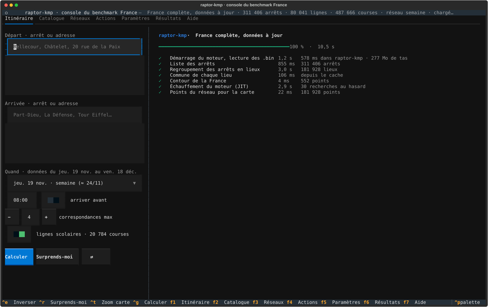

En haut, la barre de titre résume le réseau chargé : nombre d'arrêts, de lignes, de
courses, le jour type en cours, le temps de chargement et la mémoire du moteur. Juste
dessous, les onglets. En bas, les raccourcis disponibles là où l'on se trouve.

**Au démarrage**, une liste d'étapes montre le chargement en direct, chacune avec son
temps et ce qu'elle a trouvé :

1. le moteur démarre et lit les fichiers `.bin` ;
2. la liste des arrêts ;
3. les arrêts regroupés en lieux (tous les arrêts d'un même nom) ;
4. la commune de chaque lieu (quelques secondes la première fois, puis en cache) ;
5. le contour de la France ;
6. 30 recherches au hasard, pour que la JVM compile le moteur ;
7. les points du réseau pour la carte.

Une étape qui échoue dit pourquoi, et la fenêtre reste ouverte.

### Les raccourcis partout

| Touche | Effet |
|---|---|
| F1 … F7 | Changer d'onglet |
| Ctrl+P | La palette de commandes (thème clair ou sombre, captures d'écran…) |
| Ctrl+Q | Quitter |
| Tab, Maj+Tab | Passer d'un champ à l'autre |

## 4. L'onglet Itinéraire

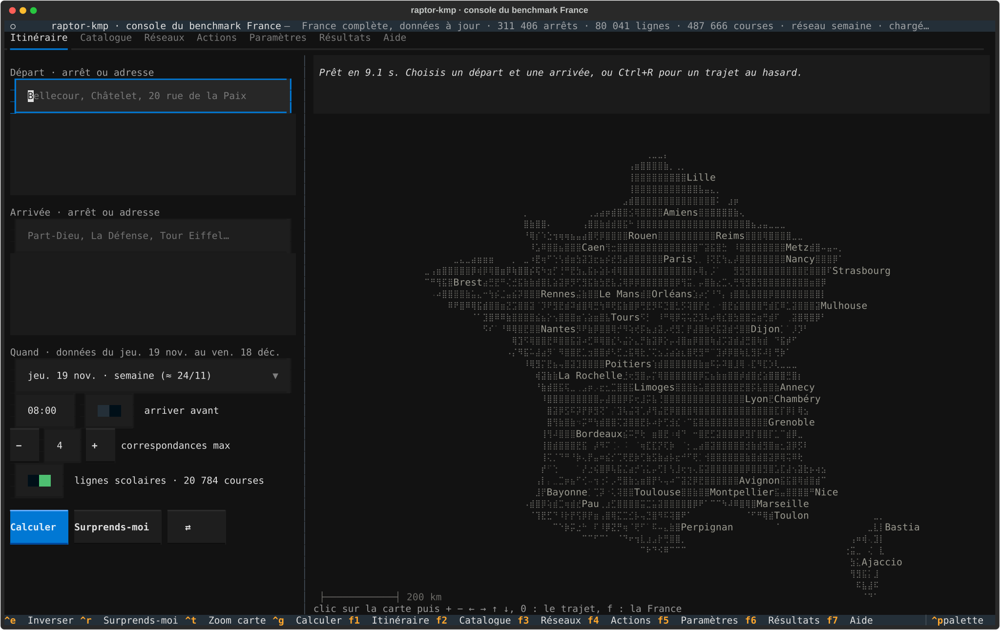

À gauche, la question : départ, arrivée, date, heure, options. À droite, la réponse : le
résumé, le détail du trajet étape par étape et la carte.

### 4.1 Chercher un arrêt

Tape quelques lettres dans **Départ**. La casse, les accents et la ponctuation ne
comptent pas, et la commune compte aussi : « lyon gambetta » trouve « Saxe - Gambetta » à
Lyon.

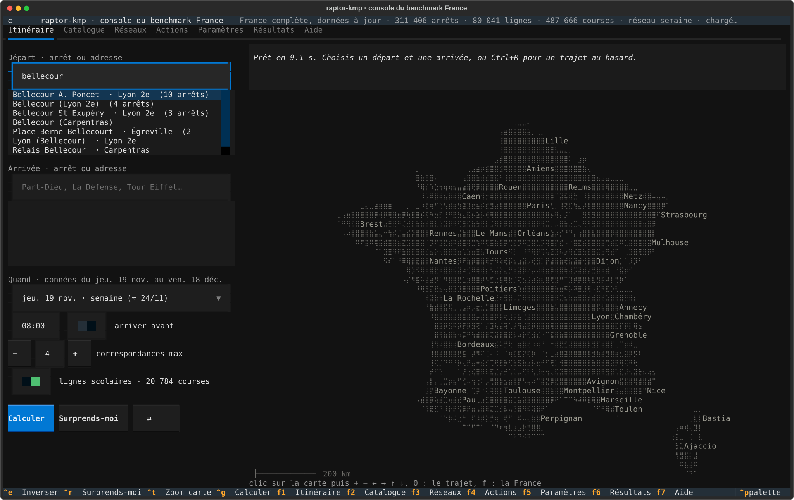

- Les lieux qui commencent par le texte tapé passent en premier, puis ceux qui le
  contiennent, puis les lieux desservis par le plus d'arrêts.
- Un **lieu**, c'est tous les arrêts qui portent ce nom : les quais d'une même station.
  La recherche part de tous à la fois.
- **Entrée** prend la suggestion en surbrillance, **↓** descend dans la liste, un clic
  aussi.

Une fois le départ choisi, le curseur passe à l'arrivée. Dès que les deux sont choisis,
le calcul part tout seul.

### 4.2 Chercher une adresse

Sous les arrêts, une section **« Adresses · Photon »** propose des adresses et des lieux
nommés (« 20 rue de la Paix Paris », « Tour Eiffel »), exactement comme dans Pelo.

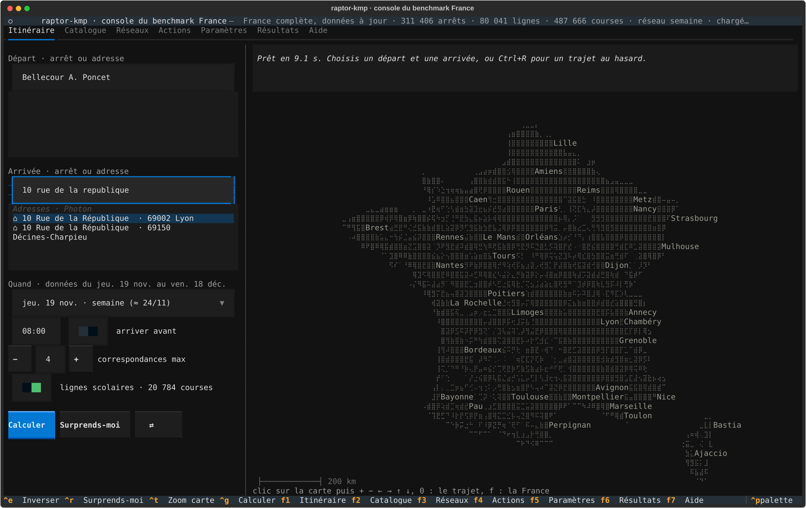

Comment ça marche :

- **Le géocodeur** est Photon (photon.komoot.io), public et sans clé. Il est interrogé à
  partir de 3 caractères, une fois que la frappe marque une pause. Il renvoie 6 résultats,
  en France métropolitaine seulement.
- **Une fois le départ choisi**, la recherche de l'arrivée privilégie les adresses proches
  de ce départ.
- **Le moteur reçoit le point lui-même.** Il marche jusqu'à tous les arrêts à moins de
  500 m, à 4,8 km/h avec un facteur de détour de 1,3. Sous 1 km, il propose aussi le trajet
  tout à pied.
- **Si rien n'est utile à 500 m**, il recommence en marchant jusqu'à 6 km (comme Pelo), et
  le résumé le signale en orange.

> **Ce qui sort de la machine :** le texte tapé est envoyé à photon.komoot.io. Les
> réponses sont gardées dans `data/tmp/explorer/geocode.json`, donc un même texte n'est
> demandé qu'une fois. Sans connexion, la section Adresses reste simplement vide, et les
> arrêts fonctionnent toujours. Le géocodage se coupe dans les Paramètres.

### 4.3 Quand : date, heure, sens

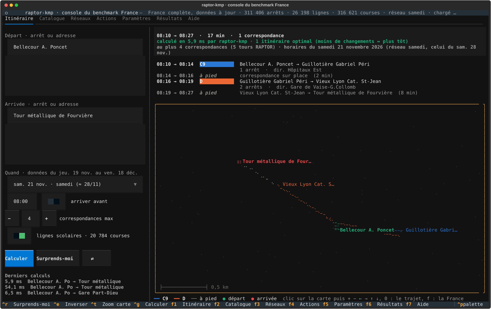

- **La date** n'existe que sur un réseau à jour (`france-live`). La liste va d'aujourd'hui
  à la fin de la fenêtre de données. Chaque date roule sur les horaires de son **jour
  type** :
  - un jour de semaine prend les horaires du mardi représentatif ;
  - un samedi, ceux du samedi ;
  - un dimanche ou un jour férié, ceux du dimanche.

  La liste l'indique : « sam. 5 déc. · samedi (≈ 28/11) ». Quand la date change de jour
  type, le moteur charge l'autre réseau, en une seconde environ. Il n'en garde qu'un en
  mémoire à la fois.
- **Sur les réseaux d'un seul jour** (les paliers du benchmark), les horaires sont ceux du
  mardi de référence, le 24 novembre 2026.
- **L'heure** s'écrit 08:15 ou 8h15. Au-delà de 24:00, on atteint les courses de fin
  de soirée (25:30 = 01:30 le lendemain).
- **« arriver avant »** cherche le départ le plus tardif qui arrive à l'heure dite.

### 4.4 Correspondances max

Les boutons − et + règlent le nombre de correspondances permises, de 0 à 99 (Entrée pour
valider une valeur tapée). C'est la limite de « tours » de RAPTOR, moins un. Les applis
utilisent 4.

Monter haut donne des trajets absurdes, ce qui est amusant. Mais chaque tour coûte environ
6 à 9 Mo de mémoire de recherche sur la France (selon la version du moteur) : au-delà de quelques dizaines, le moteur peut
répondre « pas assez de mémoire ». Il continue alors de tourner, et `--xmx` lui en donne
plus.

### 4.5 Les lignes scolaires

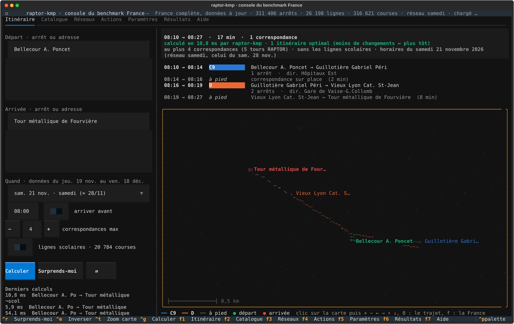

L'interrupteur **« lignes scolaires »** (allumé par défaut) garde ou écarte toutes les
lignes scolaires du réseau. À côté s'affiche le nombre de courses scolaires du jour.
Éteint, le calcul repart sans elles, et le résumé le dit.

L'interrupteur n'est actif que si le réseau a sa liste de lignes scolaires
(`school_routes.json`, écrit à la construction du réseau). Sinon il reste grisé : « pas de
liste pour ce réseau ».

Comment une ligne est reconnue comme scolaire : voir le catalogue (section 5) et le
rapport (`RESULTS.fr.md`).

### 4.6 Lire le résultat

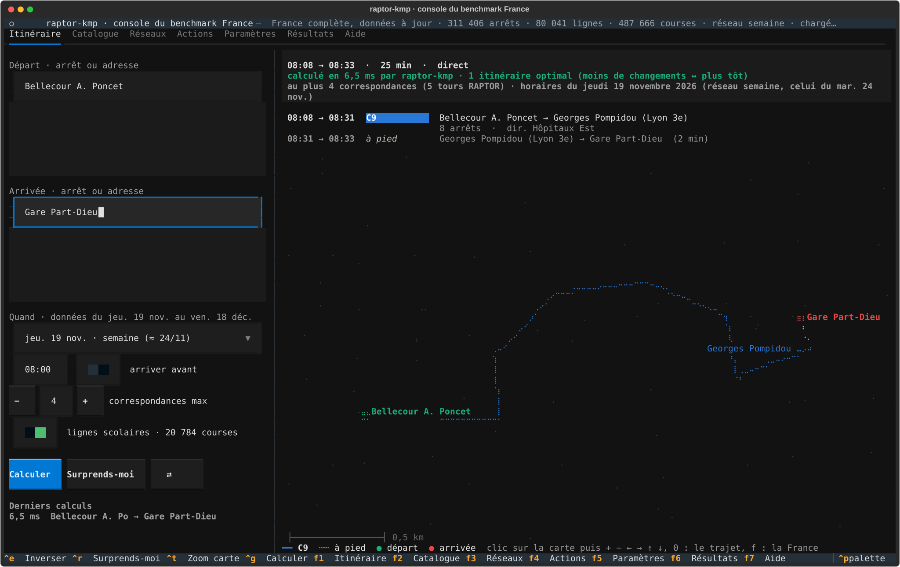

**Le résumé**, en haut à droite, donne :

- l'heure de départ et d'arrivée, la durée et le nombre de correspondances ;
- le temps de calcul de raptor-kmp et le nombre d'itinéraires optimaux trouvés ;
- la limite de correspondances, le jour et ses horaires.

**Les itinéraires optimaux** : raptor-kmp renvoie, pour chaque nombre de correspondances,
le trajet qui arrive le plus tôt. Moins de changements ou une arrivée plus tôt : c'est
ce choix que la liste montre, quand il y a plus d'un trajet. Les flèches la parcourent, et
la carte suit.

**Le détail** donne, pour chaque étape :

- l'heure ;
- la ligne, avec sa couleur sur la carte ;
- le trajet, le nombre d'arrêts et la direction.

Les marches sont en gris. « Correspondance sur place » veut dire un changement de quai
sans changer d'arrêt.

**L'historique**, en bas à gauche, garde les derniers calculs et leur temps.

### 4.7 La carte

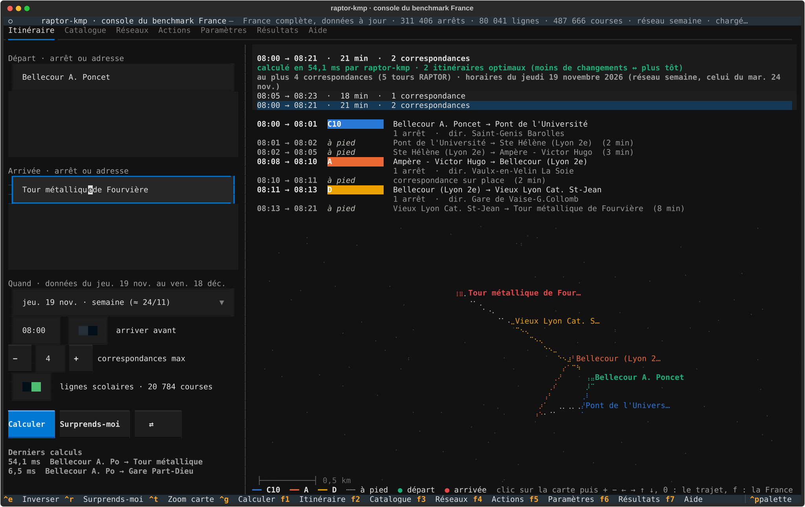

La carte est dessinée en braille : chaque caractère est une grille de 2 × 4 points. On y
voit :

- **le contour de la France**, et **le réseau** en points discrets, plus clairs là où les
  arrêts sont denses (les villes ressortent) ;
- **le trajet** : chaque ligne dans sa couleur, la marche en pointillés, le départ en vert
  et l'arrivée en rouge ;
- **des noms** : le départ, l'arrivée et les arrêts de correspondance quand la carte suit
  un trajet, les grandes villes quand elle montre le pays ;
- **une échelle** en bas à gauche, et **une légende** dessous : chaque ligne du trajet,
  la marche, le départ et l'arrivée.

**Se déplacer :** clique sur la carte, son cadre s'allume, puis :

| Touche | Effet |
|---|---|
| + | Zoomer (×2) |
| − | Dézoomer |
| ← → ↑ ↓ | Se déplacer d'un quart de la carte |
| 0 | Revenir au trajet |
| f | Toute la France |
| Ctrl+T | Basculer entre le trajet et la France (depuis n'importe où) |

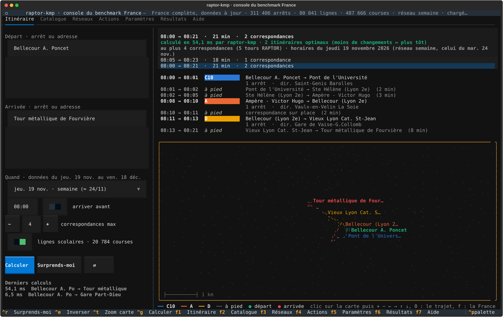

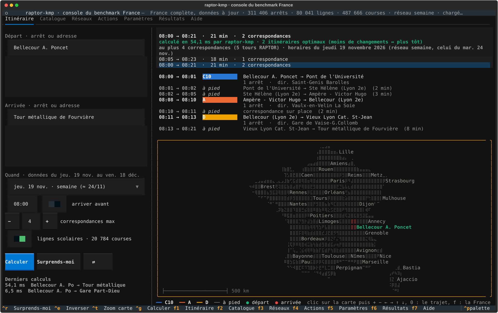

### 4.8 Les raccourcis de l'itinéraire

| Touche | Effet |
|---|---|
| Ctrl+G | Calculer |
| Ctrl+R | « Surprends-moi » : deux lieux au hasard, à 2 à 40 km l'un de l'autre, et une heure au hasard |
| Ctrl+E | Inverser départ et arrivée |
| Ctrl+T | Zoom de la carte : trajet ou France |

## 5. L'onglet Catalogue

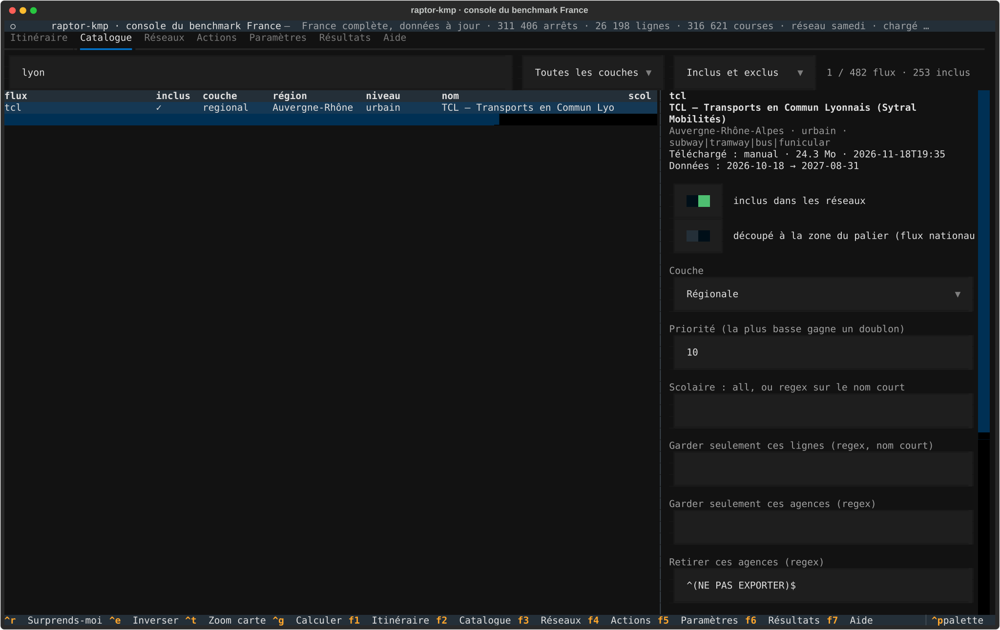

Le catalogue (`catalog/gtfs_france.csv`) est la liste de toutes les sources GTFS
connues : 482 lignes, chacune incluse ou non, avec la raison dans ses notes. C'est lui qui
décide de ce qui entre dans les réseaux.

**Trouver une source.** Le champ de recherche filtre sur l'identifiant, le nom, la région,
la métropole et les notes. Deux listes filtrent par couche et par statut (inclus ou
exclus). Le compteur dit combien de sources sont affichées et combien sont incluses.

Le tableau montre, pour chaque source :

- son identifiant ;
- si elle est incluse ;
- sa couche, sa région, son niveau et son nom ;
- sa règle scolaire ;
- **la fin de ses données** (le dernier jour d'horaires du fichier téléchargé) ;
- le statut de son dernier téléchargement.

**La fiche d'une source**, à droite, rappelle le téléchargement : statut, taille, date,
période couverte et erreur éventuelle. Elle permet de modifier :

| Champ | Effet |
|---|---|
| inclus dans les réseaux | La source entre (ou sort) de tous les réseaux de sa couche |
| découpé à la zone du palier | Pour les flux nationaux : un palier n'en garde que ce qui est dans sa zone |
| Couche | `regional` (les paliers), `longue_distance` (France connexe), `scolaire` (France complète) |
| Priorité | Quand la même course vient de deux sources, la priorité la plus basse gagne (urbain 10, ferroviaire et national 15, interurbain 20, agrégat 30, scolaire 90) |
| Scolaire | `all` : toutes ses lignes sont scolaires ; sinon une expression régulière sur le nom court des lignes scolaires (`^Ts\d` à Rennes) |
| Garder seulement ces lignes | Expression régulière sur le nom court : le reste de la source est ignoré (il vient d'ailleurs) |
| Garder / retirer ces agences | Expressions régulières sur le nom de l'agence : pour sortir d'un agrégat un réseau pris à sa source |
| Garder / retirer des courses par arrêt | Expressions régulières sur l'identifiant d'arrêt (c'est ainsi que le flux SNCF est coupé en TER et grandes lignes) |
| URL | Le lien vers la dernière version |
| Notes | Pourquoi la ligne est ce qu'elle est |

- **Enregistrer** vérifie la fiche : la priorité doit être un nombre, et les expressions
  régulières doivent être valides. La version précédente du catalogue est copiée dans
  `data/tmp/catalog-backups/`.
- **Télécharger ce flux** lance le téléchargement de cette seule source (onglet Actions).
- **Annuler** revient à la fiche enregistrée.

> Une modification du catalogue ne change pas tout de suite les réseaux déjà construits.
> Elle compte à la prochaine construction : la mise à jour quotidienne pour `france-live`,
> « Construire les variantes France » pour les autres.

## 6. L'onglet Réseaux

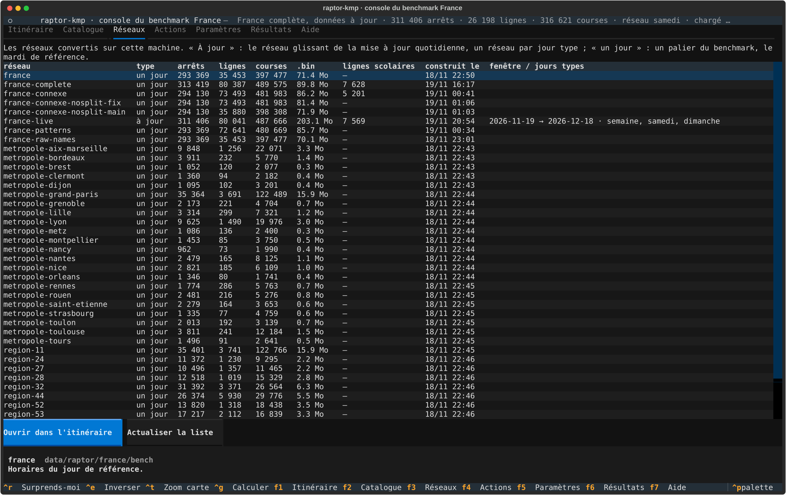

La liste des réseaux convertis sur la machine (`data/raptor/`), avec pour chacun :

- son type ;
- ses arrêts, lignes et courses ;
- la taille de ses fichiers `.bin` ;
- son nombre de lignes scolaires ;
- sa date de construction.

| Type | Ce que c'est |
|---|---|
| **à jour** | `france-live`, le réseau de la mise à jour quotidienne. Un réseau par jour type (semaine, samedi, dimanche, et vacances quand la fenêtre en contient), valable sur la fenêtre affichée |
| **un jour** | Les réseaux du benchmark : les 22 métropoles, les 13 régions, la France juxtaposée, connexe, complète… Horaires du mardi de référence |

**Ouvrir dans l'itinéraire** redémarre le moteur sur le réseau choisi et ramène à
l'onglet Itinéraire, où la liste de chargement se déroule à nouveau. **Actualiser la
liste** relit le dossier, ce qui est utile après une construction.

## 7. L'onglet Actions

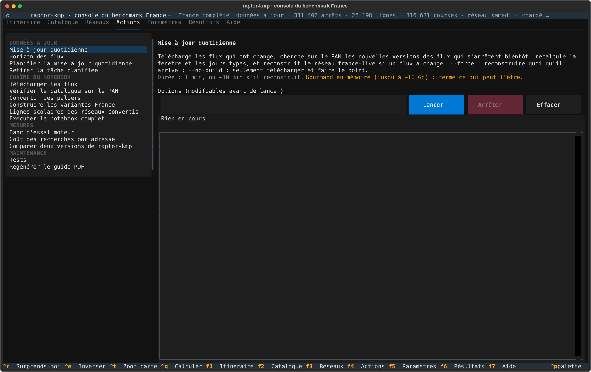

Chaque étape du benchmark est une action :

1. choisis-la à gauche ;
2. lis ce qu'elle fait, sa durée et la mémoire qu'elle demande ;
3. ajuste ses options si besoin ;
4. clique sur **Lancer**.

Sa sortie s'affiche en direct, avec le temps écoulé. **Arrêter** l'interrompt, et
**Effacer** vide le journal.

Une seule action tourne à la fois. Les actions marquées « gourmand en mémoire »
(pipeline, construction de France) prennent jusqu'à 10 Go : mieux vaut ne pas en lancer
pendant un gros calcul ailleurs.

| Action | Commande | Durée | Quand l'utiliser |
|---|---|---|---|
| Mise à jour quotidienne | `gtfs_bench.refresh` | 1 min, ~10 min si elle reconstruit | Remettre `france-live` à jour (`--force` : reconstruire de toute façon ; `--no-build` : seulement faire le point) |
| Horizon des flux | `gtfs_bench.horizon` | ~1 min | Voir jusqu'où chaque flux publie, et la fenêtre qui en découle |
| Planifier la mise à jour quotidienne | PowerShell | instantané | Créer la tâche Windows qui lance la mise à jour chaque jour à l'heure des paramètres, et au réveil si le PC dormait |
| Retirer la tâche planifiée | PowerShell | instantané | La supprimer |
| Télécharger les flux | `gtfs_bench.download` | 1 à 5 min | Récupérer les dernières versions (`--feeds a,b` pour quelques-unes, `--force` pour tout) |
| Vérifier le catalogue sur le PAN | `gtfs_bench.catalog check` | ~30 s | Ressources disparues, URL changées, flux expirés, nouveaux candidats |
| Convertir des paliers | `gtfs_bench.convert` | 1 s à 45 min | Repasser des réseaux fusionnés dans le pipeline (`--tiers metropole:lyon,france`) |
| Construire les variantes France | `gtfs_bench.connected` | ~25 min par variante | France juxtaposée, une ligne par desserte, connexe, complète : fusion, pipeline, mesures, audit, préfectures |
| Lignes scolaires des réseaux convertis | `gtfs_bench.connected --school-only` | ~5 min | Refaire la liste des lignes scolaires et mesurer l'interrupteur |
| Exécuter le notebook complet | `jupyter nbconvert` | 1 à 2 h | Toute la chaîne, comme dans Jupyter ; la copie exécutée va dans `data/tmp/notebook` |
| Banc d'essai moteur | `gtfs_bench.engine` | 1 à 10 min | Chargement, mémoire, temps de recherche d'un réseau |
| Coût des recherches par adresse | `gtfs_bench.engine --addresses` | ~10 min | Comparer recherches depuis un arrêt et depuis une adresse |
| Comparer deux versions de raptor-kmp | `gtfs_bench.engines compare` | 5 min à 1 h | Mêmes trajets ? Combien de mémoire, quel temps, quel plus petit tas ? |
| Tests | `pytest` | ~1 min | La suite de tests du benchmark |
| Régénérer le guide PDF | `gtfs_bench.guide` | ~1 min | Refaire ce guide et ses captures |

Quand une action qui construit des réseaux se termine, une notification invite à les
recharger (Réseaux → Ouvrir).

## 8. L'onglet Paramètres

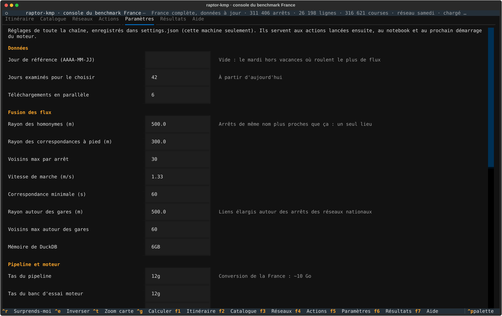

Tous les réglages de la chaîne, groupés par thème. Ils sont enregistrés dans
`benchmark/settings.json`, qui n'est pas versionné : ce sont ceux de cette machine. Le
fichier ne garde que ce qui diffère des valeurs par défaut.

Ces réglages servent :

- aux actions lancées ensuite ;
- au notebook, dont la cellule de configuration les lit ;
- au prochain démarrage du moteur (Réseaux → Ouvrir).

**Revenir aux valeurs par défaut** remet les valeurs d'origine dans le formulaire : il
reste à cliquer sur Enregistrer.

| Réglage | Défaut | Effet |
|---|---|---|
| **Données** | | |
| Jour de référence | vide | Le mardi des paliers du benchmark ; vide : le mardi hors vacances où roulent le plus de flux |
| Jours examinés pour le choisir | 42 | À partir d'aujourd'hui |
| Téléchargements en parallèle | 6 | |
| **Fusion des flux** | | |
| Rayon des homonymes | 500 m | Des arrêts de même nom plus proches que ça forment un seul lieu ; au-delà, ils prennent le nom de leur commune |
| Rayon des correspondances à pied | 300 m | Jusqu'où une correspondance à pied est créée entre deux arrêts |
| Voisins max par arrêt | 30 | |
| Vitesse de marche | 1,33 m/s | Celle du pipeline |
| Correspondance minimale | 60 s | |
| Rayon autour des gares | 500 m | Liens élargis autour des arrêts des réseaux nationaux (gare ↔ métro) |
| Voisins max autour des gares | 60 | |
| Mémoire de DuckDB | 6GB | La fusion déborde sur disque au-delà |
| **Pipeline et moteur** | | |
| Tas du pipeline | 12g | La France demande environ 10 Go |
| Tas du banc d'essai moteur | 12g | |
| Tours RAPTOR par défaut | 5 | Correspondances + 1, pour les mesures |
| Version de raptor-kmp du banc d'essai | 2.2.0 | |
| **Réseau à jour** | | |
| Part max d'un flux qui s'arrête avant la fin | 0,005 | Un flux plus gros que ça fixe la fin de la fenêtre |
| Part max perdue au total | 0,01 | Les petits flux arrêtés en route, cumulés |
| Jours examinés en avant | 300 | |
| Flux « bientôt arrêtés » | 35 j | Pour chercher sur le PAN une version plus récente |
| Heure de la mise à jour quotidienne | 04:00 | Pour la tâche planifiée |
| **Lignes scolaires** | | |
| Courses max d'une ligne scolaire « devinée » | 6 | Une ligne qui dessert un établissement et roule au plus autant de fois est scolaire |
| **Explorateur** | | |
| Réseau ouvert au démarrage | vide | Vide : `france-live` s'il existe, sinon `france` |
| Tas du moteur de l'explorateur | 2g | |
| Correspondances max par défaut | 4 | |
| Recherche d'adresses | oui | Non : plus aucune requête à Photon |
| Marche élargie si rien à 500 m | 6000 m | 0 : pas de second essai |

## 9. L'onglet Résultats

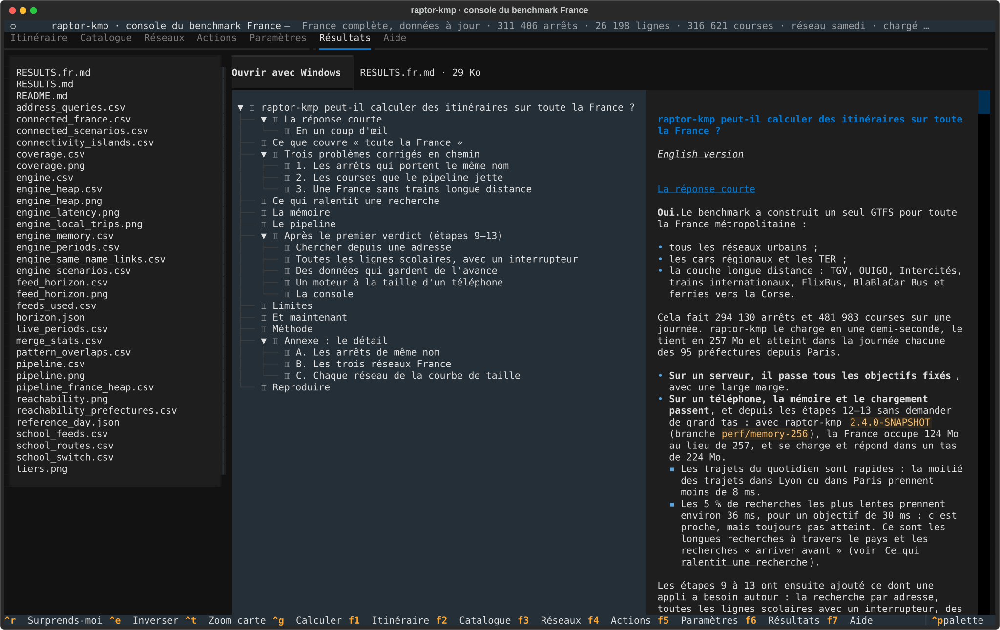

À gauche, les rapports (`RESULTS.fr.md`, `RESULTS.md`, `README.md`) puis tous les
fichiers de `results/` :

- **les rapports et le texte** s'affichent mis en forme, avec leur table des matières ;
- **les tableaux CSV** s'affichent en tableau (les 1 000 premières lignes) ;
- **les images** s'ouvrent dans la visionneuse de Windows (« Ouvrir avec Windows »).

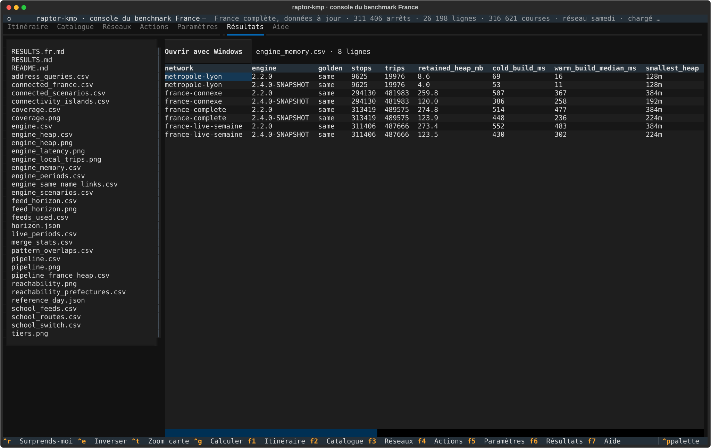

Les fichiers à connaître :

| Fichier | Contenu |
|---|---|
| `connected_france.csv` | Les réseaux France côte à côte : taille, mémoire, temps, préfectures |
| `engine_memory.csv` | raptor-kmp 2.2.0 contre 2.4.0 : trajets identiques, mémoire, temps, plus petit tas |
| `engine_periods.csv` | Les trois jours types l'un après l'autre sous un petit tas |
| `address_queries.csv` | Ce que coûte une recherche par adresse |
| `school_routes.csv` | Chaque ligne scolaire, avec la règle qui l'a reconnue |
| `school_switch.csv` | Les mêmes trajets avec et sans lignes scolaires |
| `feed_horizon.csv` / `.png` | Jusqu'où chaque flux publie, et la fenêtre |
| `reachability_prefectures.csv` | Paris → chaque préfecture |

## 10. L'onglet Aide

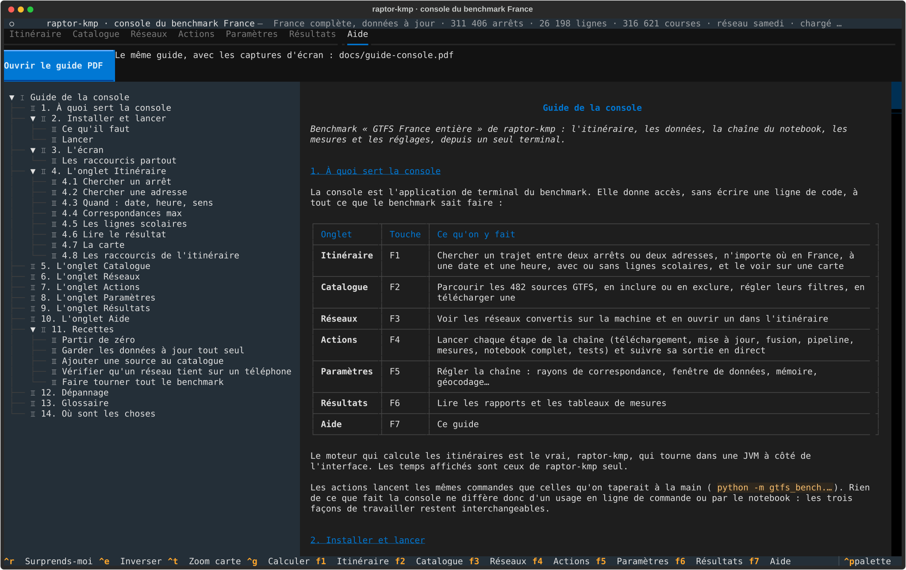

Ce guide, dans le terminal, avec sa table des matières. **Ouvrir le guide PDF** ouvre la
version PDF, avec les images.

## 11. Recettes

### Partir de zéro

1. Compile le moteur et le pipeline (section 2).
2. **Actions → Télécharger les flux.** Pour Lyon (TCL), le fichier se télécharge à la main
   depuis Data Grand Lyon, avec un compte GrandLyon Connect. Il se place dans
   `data/raw/tcl.zip`, puis on lance `python -m gtfs_bench.download --register tcl`.
3. **Actions → Mise à jour quotidienne** : elle construit `france-live` (~10 min, ~10 Go
   de mémoire).
4. **Réseaux → france-live → Ouvrir.**

### Garder les données à jour tout seul

**Actions → Planifier la mise à jour quotidienne**, puis Lancer. La tâche Windows
« raptor-gtfs-refresh » lance la mise à jour chaque jour à l'heure des paramètres (4 h par
défaut), et au réveil suivant si le PC dormait. Son journal est dans `data/logs/`.

Pour la retirer : **Retirer la tâche planifiée**.

### Ajouter une source au catalogue

1. **Catalogue**, puis cherche la source.
2. Coche « inclus », choisis la couche et règle la priorité et les filtres. Enregistre.
3. **Télécharger ce flux.**
4. Reconstruis le réseau : **Mise à jour quotidienne** avec `--force`, ou **Construire les
   variantes France**.
5. **Réseaux → Ouvrir.**

### Vérifier qu'un réseau tient sur un téléphone

1. **Actions → Comparer deux versions de raptor-kmp**, avec
   `compare 2.2.0 2.4.0-SNAPSHOT --networks france-complete`.
2. **Résultats** → `engine_memory.csv` : colonnes `retained_heap_mb` et `smallest_heap`.

### Faire tourner tout le benchmark

**Actions → Exécuter le notebook complet** (1 à 2 h). La copie exécutée, avec ses
graphiques, est dans `data/tmp/notebook`.

## 12. Dépannage

| Symptôme | Cause probable | Que faire |
|---|---|---|
| « engine did not start » au chargement | Java absent, ou trop ancien | Installer un JDK 21, ou passer `--java` |
| « no routes.bin » | Le réseau n'est pas converti | Actions → Mise à jour quotidienne, ou Construire les variantes |
| « Pas assez de mémoire » sur un calcul | Trop de correspondances pour le tas du moteur | Baisser la limite, ou relancer avec `--xmx 4g` |
| Pas d'adresses proposées | Pas de connexion, Photon indisponible, ou géocodage coupé | Vérifier la connexion et Paramètres → Explorateur |
| Le pipeline échoue en mémoire | Moins de 12 Go libres | Fermer des applications, ou baisser « Tas du pipeline » (la France demande ~10 Go) |
| Téléchargement TCL en erreur 401 | Data Grand Lyon refuse le script | Télécharger à la main, puis `--register tcl` (section 11) |
| Une action longue a « échoué » après une heure | Le PC s'est mis en veille | Relancer ; pour la nuit, la tâche planifiée rattrape au réveil |
| Gradle échoue avec « Internal compiler error … 25 » | Le démon Gradle tourne sur le JDK 25 | `./gradlew --stop`, puis relancer avec `JAVA_HOME` sur le JDK 21 |
| Le build de raptor-kmp refuse le plugin Android | AGP 9 et Kotlin Multiplatform | `-Pandroid.builtInKotlin=false -Pandroid.newDsl=false`, ce que fait `gtfs_bench.engines` |
| La carte affiche des carrés | La police du terminal n'a pas le braille | Windows Terminal avec Cascadia Mono, ou une police « Nerd Font » |

## 13. Glossaire

| Terme | Sens |
|---|---|
| **GTFS** | Le format standard des horaires de transport : arrêts, lignes, courses, calendriers |
| **PAN** | Le point d'accès national, transport.data.gouv.fr, où les réseaux publient leurs GTFS |
| **raptor-kmp** | Le moteur d'itinéraires de Pelo (algorithme RAPTOR, Kotlin Multiplatform) |
| **Pipeline** | raptor-gtfs-pipeline : il convertit un GTFS en fichiers `stops.bin` et `routes.bin` pour raptor-kmp |
| **Tour (RAPTOR)** | Un trajet en véhicule ; tours = correspondances + 1 |
| **Palier** | Un réseau du benchmark : une métropole, une région ou la France |
| **France connexe** | La France avec la couche longue distance (TGV, Intercités, cars, ferries) |
| **France complète** | France connexe plus les réseaux scolaires |
| **france-live** | Le réseau tenu à jour chaque jour, avec un réseau par jour type |
| **Jour type** | Semaine, samedi, dimanche (et vacances) : les horaires d'un jour représentatif |
| **Fenêtre** | La période sur laquelle tous les flux qui comptent ont publié leurs horaires |
| **Tas (heap)** | La mémoire que la JVM donne au moteur ; `-Xmx` en fixe le maximum |
| **p50, p95, p99** | Les temps sous lesquels se terminent 50 %, 95 %, 99 % des recherches |

## 14. Où sont les choses

| Chemin | Contenu |
|---|---|
| `catalog/gtfs_france.csv` | Le catalogue des sources |
| `settings.json` | Les paramètres de cette machine |
| `data/raw/` | Les zips téléchargés et leur manifeste |
| `data/normalized/` | Chaque source nettoyée (parquet) |
| `data/merged/` | Les réseaux fusionnés (GTFS zip) |
| `data/raptor/` | Les réseaux convertis (`.bin`), dont `france-live` |
| `data/logs/` | Les journaux de la mise à jour quotidienne |
| `data/tmp/catalog-backups/` | Les versions précédentes du catalogue |
| `results/` | Toutes les mesures |
| `RESULTS.fr.md` | Le rapport |
| `notebooks/gtfs_france.ipynb` | Le notebook de la chaîne complète |
| `docs/` | Ce guide, sa source et ses captures |
| `refresh.ps1` | Le script de la tâche planifiée |
