# Guide de la console

*france-live dans un terminal : les itinéraires, les mises à jour par différences et les
données de la livraison officielle.*

## 1. À quoi sert la console

La console est une application de terminal qui montre france-live tel que les applis le
reçoivent. Elle télécharge le réseau de toute la France depuis la livraison officielle
(`api.dotshell.eu`), le tient à jour, et calcule des itinéraires dessus avec le vrai moteur.

| Onglet | Touche | Ce qu'on y fait |
|---|---|---|
| **Itinéraire** | F1 | Chercher un trajet entre deux arrêts ou deux adresses, n'importe où en France, à une date et une heure, avec ou sans lignes scolaires, et le voir sur une carte |
| **Mise à jour** | F2 | Voir ce que propose le serveur, installer la nouvelle version et suivre d'où vient chaque octet |
| **Données** | F3 | La version installée : sa fenêtre, ses jours types, ses sources et sa licence |
| **Paramètres** | F4 | L'adresse du serveur, la mémoire du moteur, la recherche d'adresses |
| **Aide** | F5 | Ce guide |

Deux programmes travaillent derrière l'interface, tous deux dans `console/engine` :

- **le moteur** (`ServeKt`) : raptor-kmp, le moteur d'itinéraires des applis, dans une JVM.
  Les temps affichés sont ceux de raptor-kmp seul ;
- **la mise à jour** (`SyncKt`) : dataset-sync, la bibliothèque que les applis utilisent pour
  télécharger et tenir à jour france-live. La console s'en sert telle quelle : ce qu'elle
  montre est ce que vivra un téléphone.

La console ne construit aucun réseau : c'est le travail de met-dataset-server, chaque nuit à
04:00. L'ancienne chaîne Python est rangée dans `archive/`.

## 2. Installer et lancer

### Ce qu'il faut

- **Python 3.12 ou plus récent** (le lanceur `py` de Windows suffit).
- **Java 21 ou plus récent.** Gradle en télécharge un dans `~/.gradle/jdks` pour construire
  le moteur ; pour le lancer, la console prend `JAVA_HOME`, sinon le `java` du PATH.
- **Une connexion**, pour la première installation (environ 45 Mo) puis les mises à jour
  (quelques centaines de Ko par jour).
- **Un terminal assez grand** : 160 colonnes sur 45 lignes au minimum, idéalement en plein
  écran. Windows Terminal convient très bien ; sa police (Cascadia Mono) affiche la carte en
  braille.

### Lancer

Depuis le dossier `console` :

```powershell
.\console.ps1
```

La première fois, le script crée l'environnement Python (`.venv`, depuis
`requirements.txt`) et construit le moteur (`engine`, avec Gradle). Les fois suivantes, il
démarre directement.

Sans version installée, la console s'ouvre sur **Mise à jour** : « Mettre à jour » installe
france-live.

| Option | Effet |
|---|---|
| `--data` | Le dossier des données (par défaut `console/data`) |
| `--xmx` | La mémoire du moteur (par défaut celle des paramètres, 1 Go) |
| `--java` | Le programme `java` à utiliser |

Pour quitter : **Ctrl+Q**.

## 3. L'écran

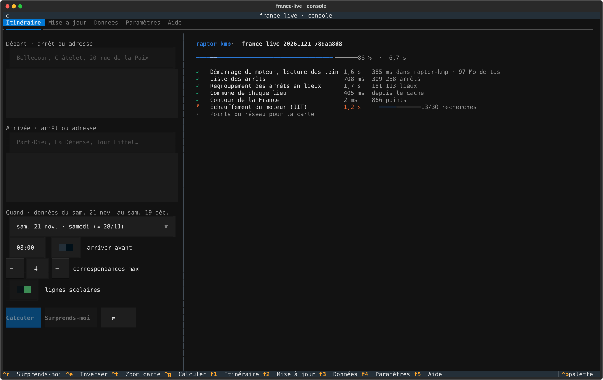

En haut, la barre de titre résume la version chargée : nombre d'arrêts, de lignes, de
courses, le jour type en cours, le temps de chargement et la mémoire du moteur. Juste
dessous, les onglets. En bas, les raccourcis disponibles là où l'on se trouve.

**Au démarrage**, une liste d'étapes montre le chargement en direct, chacune avec son
temps et ce qu'elle a trouvé :

1. le moteur démarre et lit les fichiers `.bin` du jour type d'aujourd'hui ;
2. la liste des arrêts ;
3. les arrêts regroupés en lieux (tous les arrêts d'un même nom) ;
4. la commune de chaque lieu (quelques secondes la première fois, puis en cache) ;
5. le contour de la France ;
6. 30 recherches au hasard, pour que la JVM compile le moteur ;
7. les points du réseau pour la carte.

Une étape qui échoue dit pourquoi, et la fenêtre reste ouverte. En même temps, la console
demande au serveur s'il a une nouvelle version, sans rien installer.

### Les raccourcis partout

| Touche | Effet |
|---|---|
| F1 … F5 | Changer d'onglet |
| Ctrl+P | La palette de commandes (thème clair ou sombre, captures d'écran…) |
| Ctrl+Q | Quitter |
| Tab, Maj+Tab | Passer d'un champ à l'autre |

## 4. L'onglet Itinéraire

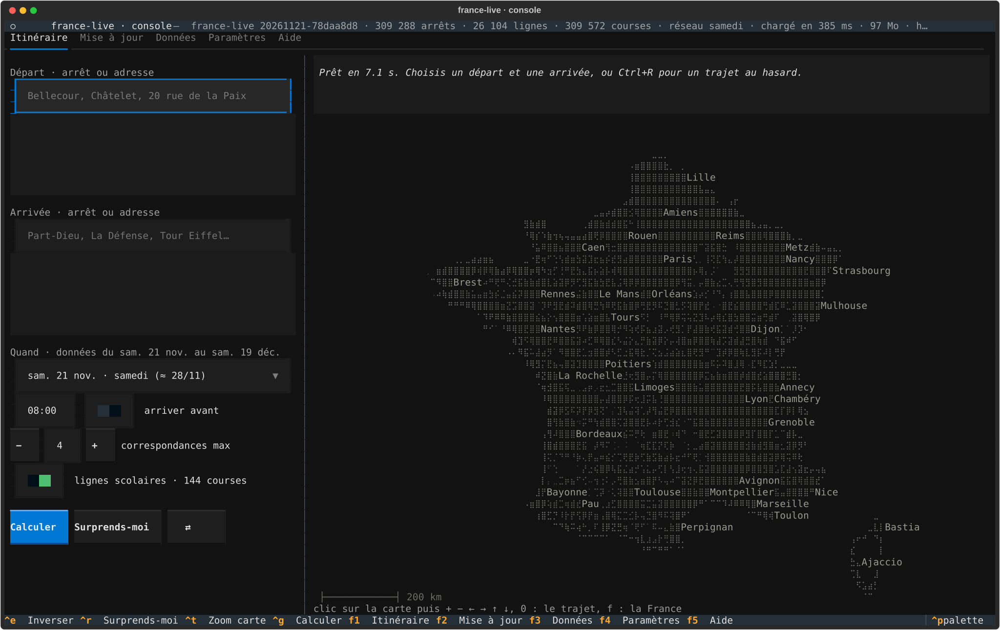

À gauche, la question : départ, arrivée, date, heure, options. À droite, la réponse : le
résumé, le détail du trajet étape par étape et la carte.

### 4.1 Chercher un arrêt

Tape quelques lettres dans **Départ**. La casse, les accents et la ponctuation ne
comptent pas, et la commune compte aussi : « lyon gambetta » trouve « Saxe - Gambetta » à
Lyon.

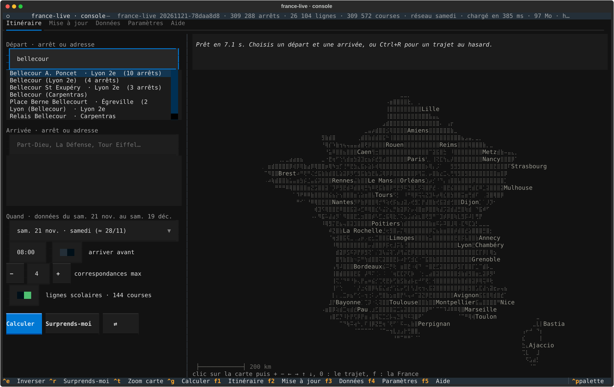

- Les lieux qui commencent par le texte tapé passent en premier, puis ceux qui le
  contiennent, puis les lieux desservis par le plus d'arrêts.
- Un **lieu**, c'est tous les arrêts qui portent ce nom : les quais d'une même station.
  La recherche part de tous à la fois.
- **Entrée** prend la suggestion en surbrillance, **↓** descend dans la liste, un clic
  aussi.

Une fois le départ choisi, le curseur passe à l'arrivée. Dès que les deux sont choisis,
le calcul part tout seul.

### 4.2 Chercher une adresse

Sous les arrêts, une section **« Adresses · Photon »** propose des adresses et des lieux
nommés (« 20 rue de la Paix Paris », « Tour Eiffel »), exactement comme dans Pelo.

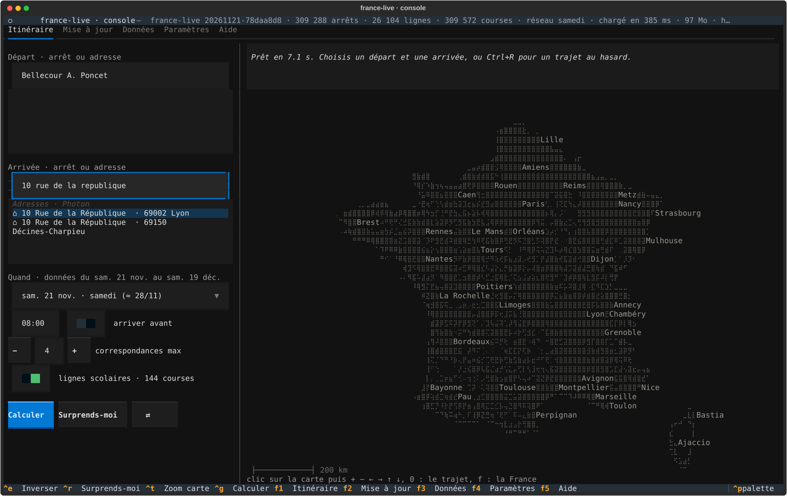

- **Le géocodeur** est Photon (photon.komoot.io), public et sans clé. Il est interrogé à
  partir de 3 caractères, une fois que la frappe marque une pause. Il renvoie 6 résultats,
  en France métropolitaine seulement.
- **Une fois le départ choisi**, la recherche de l'arrivée privilégie les adresses proches
  de ce départ.
- **Le moteur reçoit le point lui-même.** Il marche jusqu'à tous les arrêts à moins de
  500 m, à 4,8 km/h avec un facteur de détour de 1,3. Sous 1 km, il propose aussi le trajet
  tout à pied.
- **Si rien n'est utile à 500 m**, il recommence en marchant jusqu'à 6 km (comme Pelo), et
  le résumé le signale en orange.

> **Ce qui sort de la machine :** le texte tapé est envoyé à photon.komoot.io. Les
> réponses sont gardées dans `data/cache/geocode.json`, donc un même texte n'est demandé
> qu'une fois. Sans connexion, la section Adresses reste vide et les arrêts fonctionnent
> toujours. La recherche d'adresses se coupe dans les Paramètres.

### 4.3 Quand : date, heure, sens

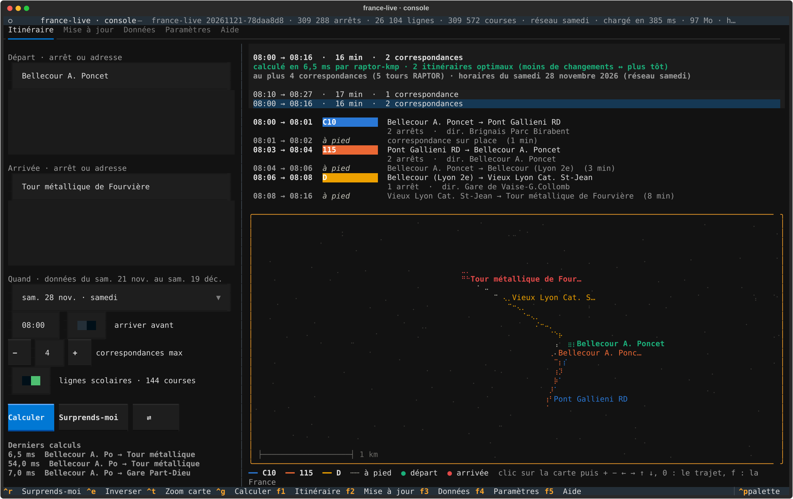

- **La date** va d'aujourd'hui à la fin de la fenêtre de la version installée (environ
  quatre semaines). france-live n'a pas d'horaires jour par jour : chaque date roule sur ceux
  de son **jour type**, pris un jour représentatif :
  - un jour de semaine prend les horaires du mardi représentatif ;
  - un samedi, ceux du samedi ;
  - un dimanche ou un jour férié, ceux du dimanche ;
  - pendant les vacances scolaires nationales, ceux d'un mardi de vacances, quand la fenêtre
    en contient.

  La liste l'indique : « sam. 5 déc. · samedi (≈ 28/11) ». Quand la date change de jour
  type, le moteur charge l'autre réseau, en une seconde environ. Il n'en garde qu'un en
  mémoire à la fois.
- **L'heure** s'écrit 08:15 ou 8h15. Au-delà de 24:00, on atteint les courses de fin
  de soirée (25:30 = 01:30 le lendemain).
- **« arriver avant »** cherche le départ le plus tardif qui arrive à l'heure dite.

### 4.4 Correspondances max

Les boutons − et + règlent le nombre de correspondances permises, de 0 à 99 (Entrée pour
valider une valeur tapée). C'est la limite de « tours » de RAPTOR, moins un. Les applis
utilisent 4.

Monter haut donne des trajets absurdes, ce qui est amusant. Mais chaque tour coûte quelques
Mo de mémoire de recherche sur la France : au-delà de quelques dizaines, le moteur peut
répondre « pas assez de mémoire ». Il continue alors de tourner, et un tas plus grand
(Paramètres) lui en donne plus.

### 4.5 Les lignes scolaires

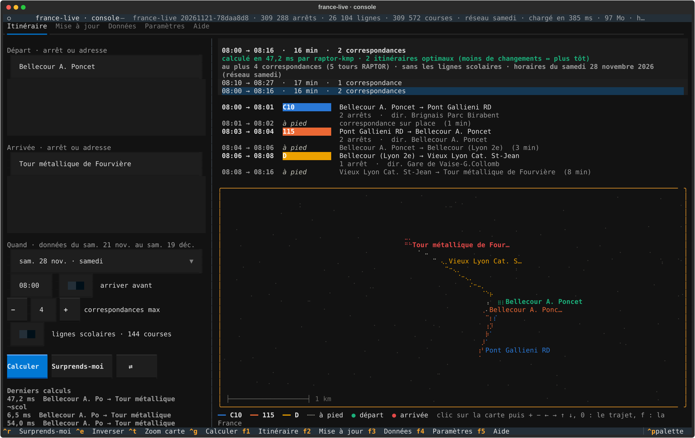

L'interrupteur **« lignes scolaires »** (allumé par défaut) garde ou écarte toutes les
lignes scolaires du jour type. À côté s'affiche le nombre de courses scolaires. Éteint, le
calcul repart sans elles, et le résumé le dit.

La liste des lignes scolaires (`school_routes.json`) est écrite par met-dataset-server avec
chaque jour type.

### 4.6 Lire le résultat

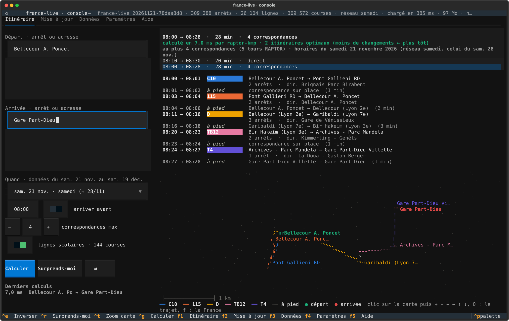

**Le résumé**, en haut à droite, donne :

- l'heure de départ et d'arrivée, la durée et le nombre de correspondances ;
- le temps de calcul de raptor-kmp et le nombre d'itinéraires optimaux trouvés ;
- la limite de correspondances, la date et le jour type dont elle prend les horaires.

**Les itinéraires optimaux** : raptor-kmp renvoie, pour chaque nombre de correspondances,
le trajet qui arrive le plus tôt. Moins de changements ou une arrivée plus tôt : c'est
ce choix que la liste montre, quand il y a plus d'un trajet. Les flèches la parcourent, et
la carte suit.

**Le détail** donne, pour chaque étape, l'heure, la ligne avec sa couleur sur la carte, le
trajet, le nombre d'arrêts et la direction. Les marches sont en gris. « Correspondance sur
place » veut dire un changement de quai sans changer d'arrêt.

**L'historique**, en bas à gauche, garde les derniers calculs et leur temps.

### 4.7 La carte

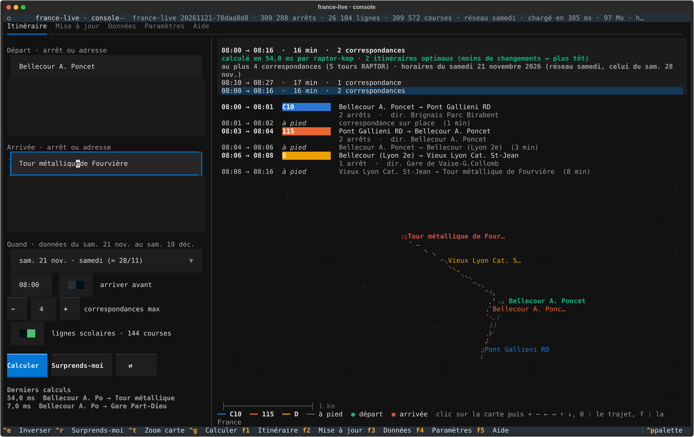

La carte est dessinée en braille : chaque caractère est une grille de 2 × 4 points. On y
voit :

- **le contour de la France**, et **le réseau** en points discrets, plus clairs là où les
  arrêts sont denses (les villes ressortent) ;
- **le trajet** : chaque ligne dans sa couleur, la marche en pointillés, le départ en vert
  et l'arrivée en rouge ;
- **des noms** : le départ, l'arrivée et les arrêts de correspondance quand la carte suit
  un trajet, les grandes villes quand elle montre le pays ;
- **une échelle** en bas à gauche, et **une légende** dessous.

**Se déplacer :** clique sur la carte, son cadre s'allume, puis :

| Touche | Effet |
|---|---|
| + | Zoomer (×2) |
| − | Dézoomer |
| ← → ↑ ↓ | Se déplacer d'un quart de la carte |
| 0 | Revenir au trajet |
| f | Toute la France |
| Ctrl+T | Basculer entre le trajet et la France (depuis n'importe où) |

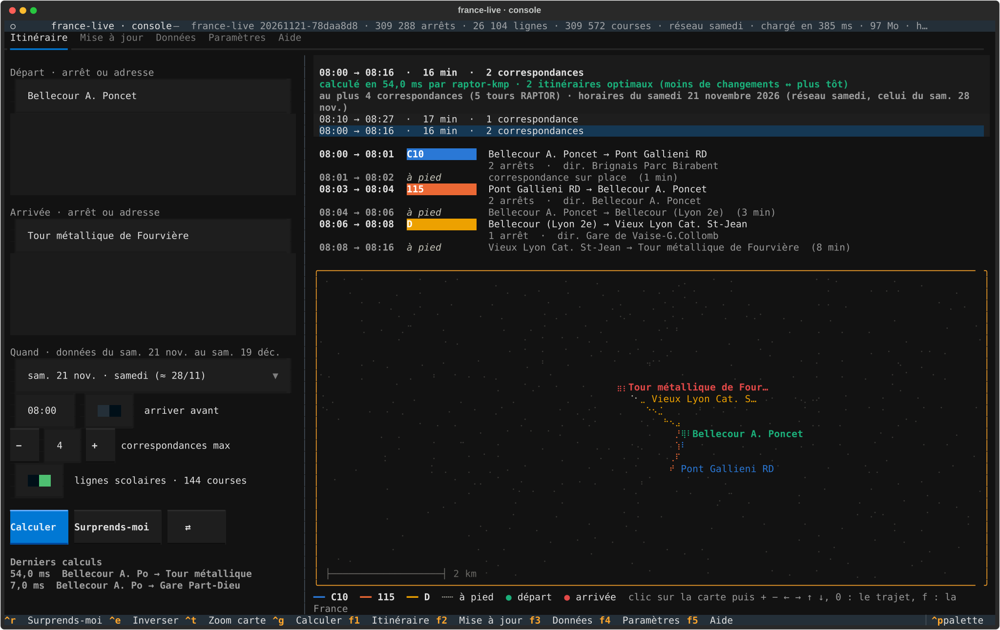

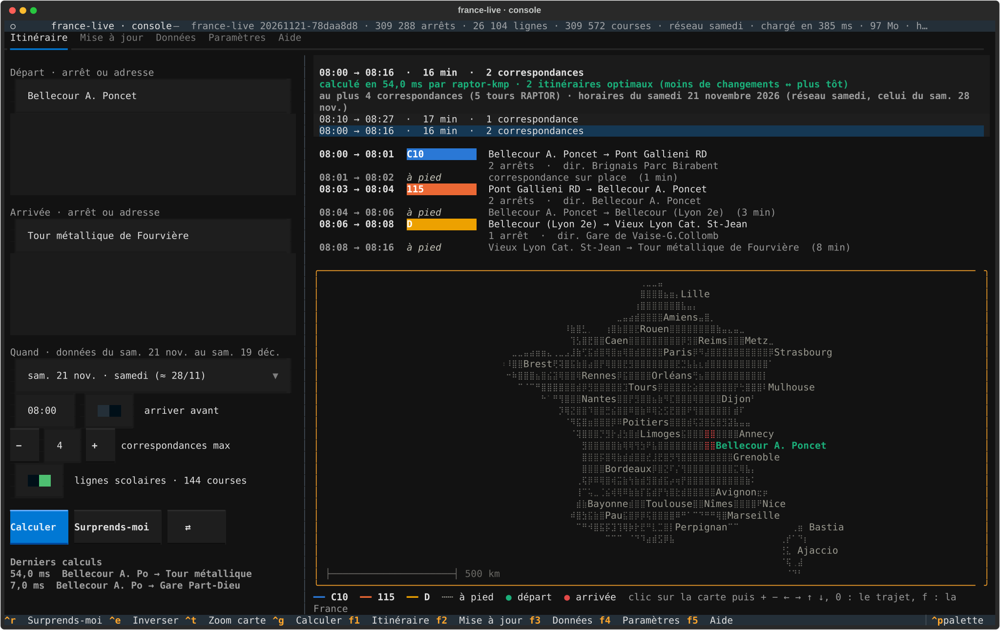

### 4.8 Les raccourcis de l'itinéraire

| Touche | Effet |
|---|---|
| Ctrl+G | Calculer |
| Ctrl+R | « Surprends-moi » : deux lieux au hasard, à 2 à 40 km l'un de l'autre, et une heure au hasard |
| Ctrl+E | Inverser départ et arrivée |
| Ctrl+T | Zoom de la carte : trajet ou France |

## 5. L'onglet Mise à jour

C'est l'onglet qui montre comment une appli tient france-live à jour.

### 5.1 Ce que propose le serveur

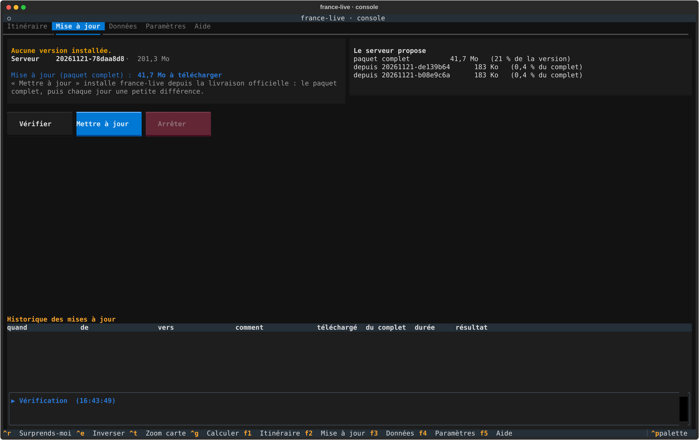

**À gauche**, la version installée et celle du serveur, et ce que coûterait la mise à jour.
**À droite**, tout ce que le serveur peut envoyer :

- **le paquet complet**, qui construit la version à partir de rien ;
- **une différence depuis chacune des versions récentes** qu'il garde (les 7 dernières, plus
  celle d'avant le dernier changement de jours types). Celle qui part de ta version est
  marquée « ← la vôtre ».

Une version trop ancienne pour avoir sa différence reçoit le paquet complet. **Vérifier**
repose la question au serveur sans rien installer ; la console le fait seule au démarrage.

### 5.2 Mettre à jour

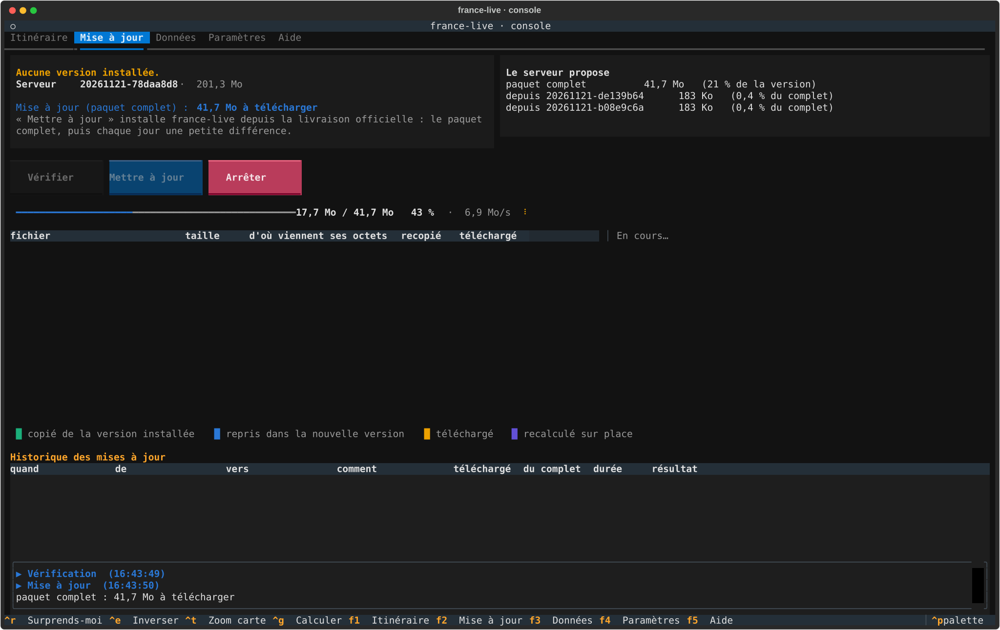

**Mettre à jour** lance dataset-sync. Il prend la voie la moins chère : la différence depuis
ta version si le serveur l'a, sinon le paquet complet. Pendant ce temps :

- **la barre** montre le téléchargement et son débit ;
- **chaque fichier** de la nouvelle version s'affiche dès qu'il est écrit et que sa somme
  SHA-256 est vérifiée, avec une barre qui dit **d'où viennent ses octets** :

| Couleur | Les octets… |
|---|---|
| vert | **copiés de la version installée** : le téléphone les avait déjà |
| bleu | **repris dans la nouvelle version** : un morceau en double, envoyé une seule fois |
| orange | **téléchargés** : ce qui a vraiment changé |
| violet | **recalculés sur place** : `index.bin`, qui se déduit de `stops.bin` et `routes.bin` |

La nouvelle version s'écrit à côté de l'ancienne. Ce n'est qu'une fois tous les fichiers
vérifiés que l'on **bascule**, d'un seul coup. Le moteur redémarre alors sur la nouvelle
version, et l'onglet Itinéraire la montre.

### 5.3 Le bilan

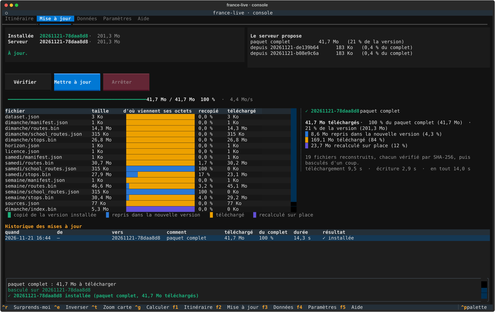

À la fin, le bilan donne :

- les octets téléchargés, rapportés au paquet complet et à la version ;
- la part de chaque provenance (copiés, repris, téléchargés, recalculés) ;
- la durée du téléchargement, celle de l'écriture, et le total.

Ordres de grandeur sur france-live : une version fait environ 200 Mo sur le disque, le
paquet complet environ 42 Mo, et une différence d'un jour à l'autre de quelques centaines
de Ko à quelques Mo.

**Pourquoi le paquet complet est si petit :**

1. **`index.bin` n'est jamais envoyé** (environ 24 Mo) : le téléphone le recalcule.
2. **Les morceaux en double** entre jours types ne voyagent qu'une fois (environ 9 Mo).
3. **Le reste est compressé** (deflate, l'algorithme des zip) environ 4 fois : les horaires
   et les suites d'arrêts se répètent beaucoup.

**Pourquoi une différence est encore plus petite :** les fichiers sont découpés en morceaux
d'environ 1 Ko selon leur contenu. Un morceau que la version installée contient déjà est
recopié sur place ; seuls les morceaux nouveaux voyagent.

### 5.4 Arrêter, reprendre, échouer

- **Arrêter** interrompt la mise à jour. La version installée n'a pas bougé et reste en
  service. Le téléchargement déjà fait est gardé : la prochaine mise à jour le **reprend**
  là où il s'était arrêté, et la barre montre en bleu clair la partie déjà là (« repris à
  … »).
- **Une coupure réseau** fait la même chose.
- **Un paquet abîmé** (somme SHA-256 fausse) ou un fichier de la version installée modifié
  à la main font échouer la mise à jour. Le bilan dit pourquoi, et la version installée
  reste intacte.

### 5.5 L'historique

Chaque mise à jour, réussie ou non, est gardée dans `data/history.json` et affichée en
bas : quand, de quelle version vers laquelle, comment, combien de téléchargé, la part du
paquet complet, la durée et le résultat.

## 6. L'onglet Données

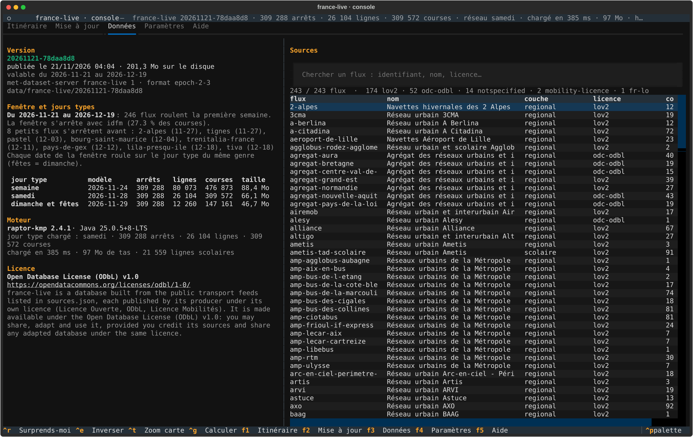

Tout ce que dit la version installée sur elle-même :

- **Version** : son numéro, sa date de publication, sa taille, ses dates de validité.
- **Fenêtre et jours types** : la période couverte, le flux qui la borne, les petits flux
  qui s'arrêtent avant la fin, et pour chaque jour type sa date modèle, ses arrêts, lignes,
  courses et sa taille.
- **Moteur** : la version de raptor-kmp, celle de Java, le jour type chargé et la mémoire
  occupée.
- **Licence** : france-live est publié sous **ODbL 1.0**. On peut le partager, l'adapter et
  s'en servir, à condition de citer ses sources et de partager une base adaptée sous la même
  licence.
- **Sources** : les flux GTFS dont la version est faite, avec leur producteur, leur couche
  et leur licence. Le champ de recherche filtre par identifiant, nom ou licence.

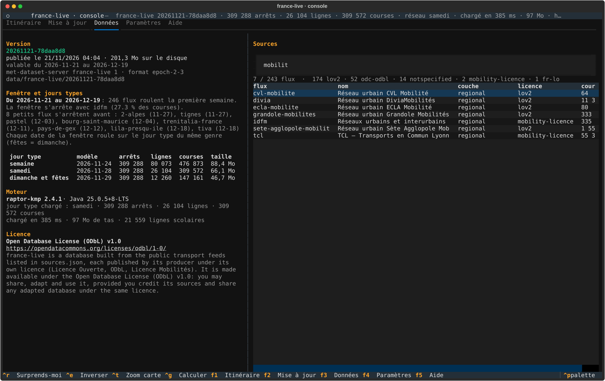

## 7. L'onglet Paramètres

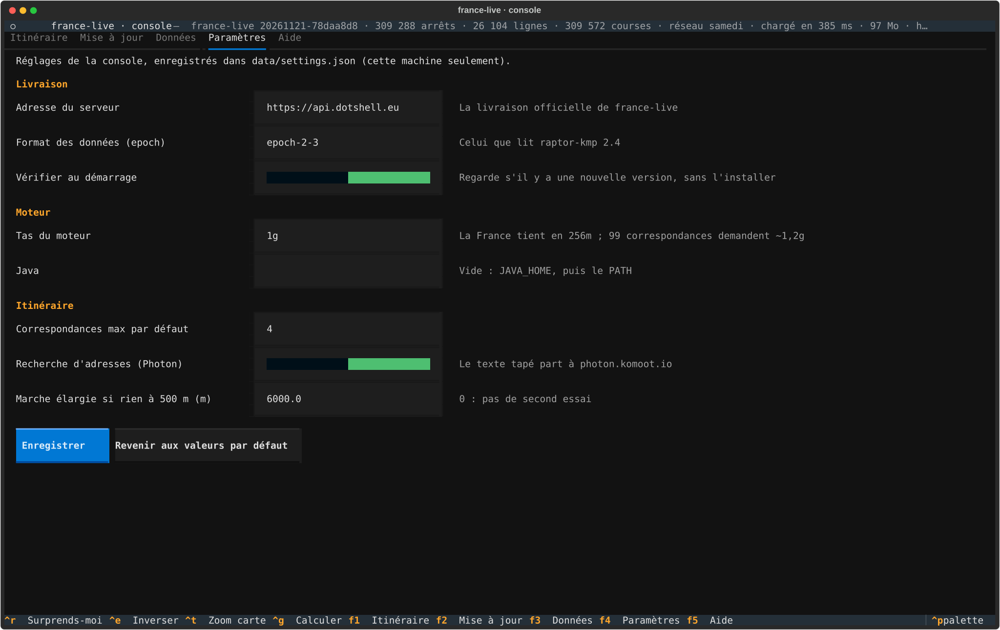

Les réglages de la console, enregistrés dans `data/settings.json` (cette machine
seulement, seulement ce qui diffère des valeurs par défaut).

| Réglage | Par défaut | Effet |
|---|---|---|
| Adresse du serveur | `https://api.dotshell.eu` | D'où viennent les versions |
| Format des données (epoch) | `epoch-2-3` | Le format que lit raptor-kmp 2.4 |
| Vérifier au démarrage | oui | Demander au serveur s'il a une nouvelle version, sans l'installer |
| Tas du moteur | `1g` | La mémoire du moteur ; la France tient en 256m, 99 correspondances demandent ~1,2g. Changer redémarre le moteur |
| Java | vide | Le `java` du moteur ; vide : `JAVA_HOME`, puis le PATH |
| Correspondances max par défaut | 4 | La valeur au démarrage |
| Recherche d'adresses | oui | Photon ; non : seulement les arrêts |
| Marche élargie | 6 000 m | Le second essai d'une adresse sans arrêt à 500 m ; 0 : pas de second essai |

## 8. L'onglet Aide

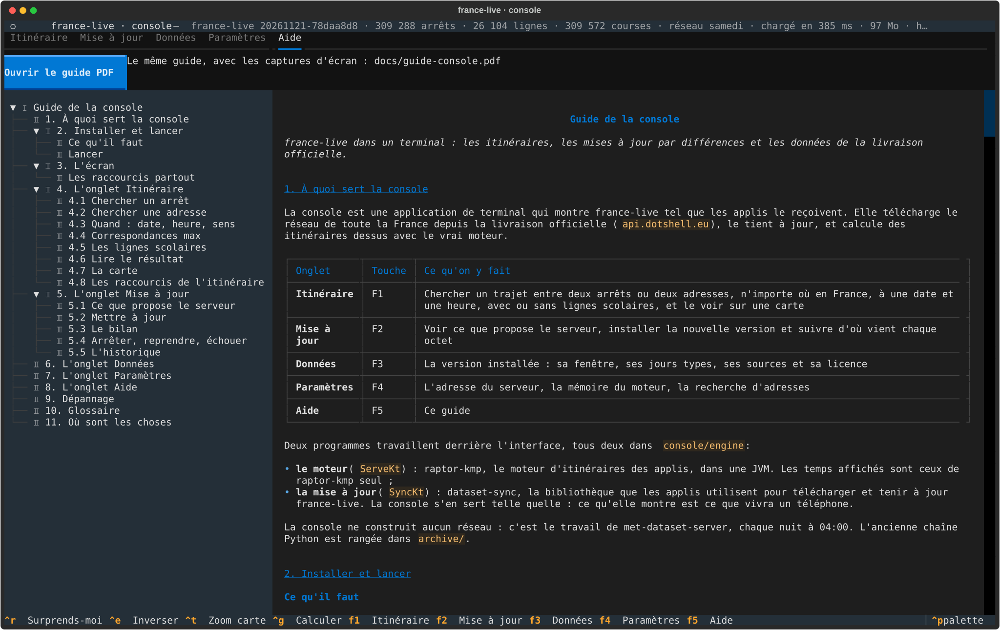

Ce guide, avec sa table des matières. Le bouton ouvre la version PDF, avec les captures
d'écran : `docs/guide-console.pdf`. Pour la régénérer :

```powershell
.venv\Scripts\python.exe -m met_console.guide
```

## 9. Dépannage

| Symptôme | Cause probable | Que faire |
|---|---|---|
| « le moteur n'est pas construit » | `engine` jamais construit | `.\console.ps1`, ou dans `engine` : `..\..\gradlew.bat installDist` |
| « engine did not start » au chargement | Java absent ou trop ancien | Installer un JDK 21, ou renseigner Java dans les Paramètres |
| La mise à jour échoue en « HTTP » ou en délai | Pas de connexion, ou serveur indisponible | Réessayer plus tard ; la version installée reste utilisable |
| « SHA-256 … expected » | Paquet abîmé en route, ou fichier installé modifié | Réessayer ; si ça persiste, effacer `data/france-live` et réinstaller |
| « Pas assez de mémoire » sur un calcul | Trop de correspondances pour le tas du moteur | Baisser la limite, ou monter le tas (Paramètres) |
| Pas d'adresses proposées | Pas de connexion, Photon indisponible, ou recherche coupée | Vérifier la connexion et les Paramètres |
| La carte affiche des carrés | La police du terminal n'a pas le braille | Windows Terminal avec Cascadia Mono |
| Gradle échoue avec « Internal compiler error … 25 » | Le démon Gradle tourne sur le JDK 25 | `..\..\gradlew.bat --stop`, puis relancer avec `JAVA_HOME` sur le JDK 21 |

## 10. Glossaire

| Terme | Sens |
|---|---|
| **GTFS** | Le format standard des horaires de transport : arrêts, lignes, courses, calendriers |
| **france-live** | Le réseau de toute la France, reconstruit chaque nuit par met-dataset-server |
| **Version** | Une construction de france-live, nommée par sa date et une empreinte : `20261121-78daa8d8` |
| **Jour type** | Semaine, samedi, dimanche (et vacances) : les horaires d'un jour représentatif |
| **Fenêtre** | La période sur laquelle tous les flux qui comptent ont publié leurs horaires |
| **Paquet complet** | Ce qu'il faut télécharger pour installer une version à partir de rien |
| **Différence** | Ce qu'il faut télécharger pour passer d'une version à la suivante |
| **dataset-sync** | La bibliothèque des applis qui installe et met à jour france-live |
| **raptor-kmp** | Le moteur d'itinéraires des applis (algorithme RAPTOR, Kotlin Multiplatform) |
| **Tour (RAPTOR)** | Un trajet en véhicule ; tours = correspondances + 1 |
| **Tas (heap)** | La mémoire que la JVM donne au moteur ; `-Xmx` en fixe le maximum |
| **ODbL** | La licence de france-live : libre, à condition de citer et de partager à l'identique |

## 11. Où sont les choses

| Chemin | Contenu |
|---|---|
| `console.ps1` | Le lanceur |
| `met_console/` | La console (Python, Textual) |
| `engine/` | Le moteur et la mise à jour (Kotlin : `ServeKt`, `SyncKt`) |
| `data/france-live/` | La version installée ; ce dossier appartient à dataset-sync |
| `data/cache/` | Contours de la France, communes, réponses de Photon |
| `data/settings.json` | Les paramètres de cette machine |
| `data/history.json` | L'historique des mises à jour |
| `docs/` | Ce guide, ses captures et le PDF |
| `tests/` | Les tests de la console |
